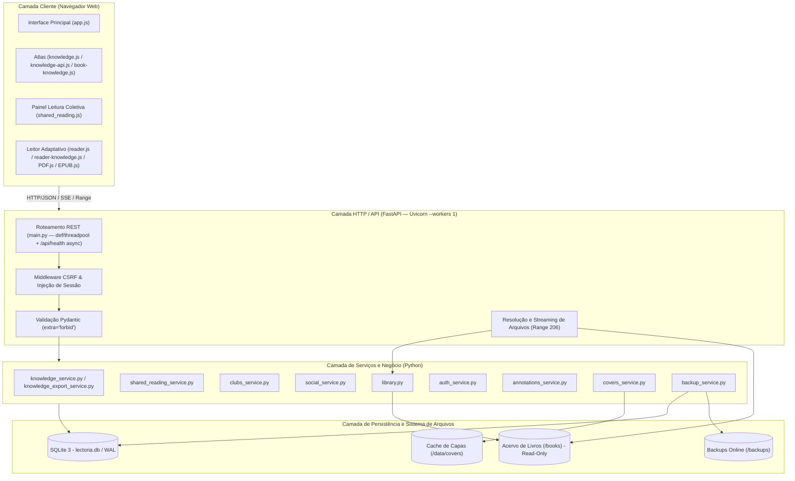
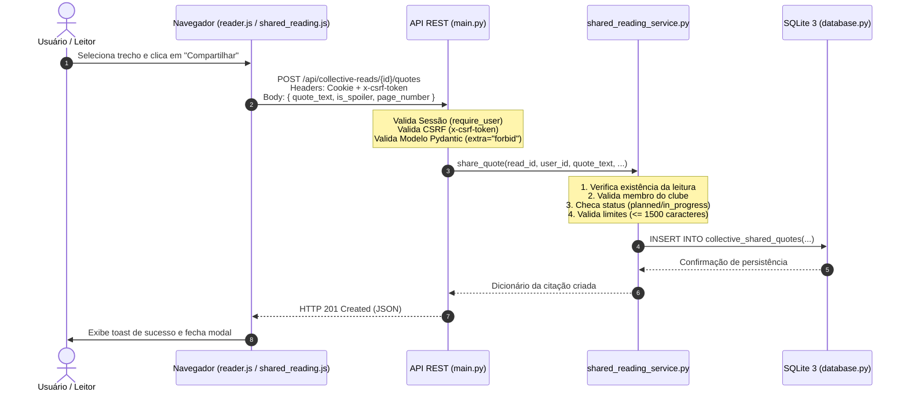

# Arquitetura do Lectoria

Este documento descreve a organização arquitetural do **Lectoria**, suas camadas de responsabilidade, o fluxo de execução das requisições e as fronteiras entre os componentes.

---

## 1. Visão Geral da Arquitetura

O Lectoria é estruturado em um padrão em camadas enxuto (*layered architecture*), projetado para execução eficiente com consumo reduzido de recursos computacionais:

---

## 2. Componentes e Responsabilidades

### 2.1 Camada Cliente (Frontend)
- **Nenhum compilador ou framework**: Construído com HTML5 semântico, CSS3 e JavaScript ES6+ puro.
- **Isolamento Modular**:
  - `static/js/app.js`: Gerencia o catálogo da biblioteca, prateleiras de descoberta, filtros combinados, cache em memória (`libraryCache`), renderização em lotes de 36 livros e modais de metadados.
  - `static/js/shared_reading.js`: Controla o painel da Leitura Compartilhada (Visão Geral, Discussões, Metas e Citações), carregamento sob demanda com `AbortController`, trava contra duplo clique (`withSubmitLock`) e máscara de spoilers fora do DOM.
  - `static/js/reader.js`: Driver dos motores PDF.js e EPUB.js, gerencia navegação por URL hash (`#page=N`, `#cfi=...`), barra de seleção flutuante com clamping horizontal e caderno de anotações.

### 2.2 Camada HTTP e Roteamento (FastAPI)
- Localizada exclusivamente em `main.py`.
- **Injeção de Dependências**:
  - `require_user(request)`: Valida token de sessão em cookie `lectoria_session` e retorna o usuário ativo.
  - `require_admin(request)`: Garante perfil de administrador do sistema.
- **Validação com Pydantic**:
  - Modelos de entrada declaram `ConfigDict(extra="forbid")`, impedindo injeção acidental de campos (*mass assignment*).
- **Proteção CSRF**:
  - Métodos mutáveis (`POST`, `PUT`, `PATCH`, `DELETE`) exigem correspondência entre cookie e cabeçalho `x-csrf-token`.
- **Tratamento Padronizado de Erros**:
  - Exceções de domínio mapeadas diretamente em códigos HTTP sem vazamento de rastreamento de pilha (stack trace) ou SQL interno.

### 2.3 Camada de Serviços (Domínio)
- Contém a inteligência e as regras de negócio desacopladas do framework web:
  - `shared_reading_service.py`: Tópicos, respostas encadeadas até nível 1, moderação (`pin`/`lock`/`soft-delete`), metas coletivas, progresso voluntário e compartilhamento de citações.
  - `clubs_service.py`: Clubes públicos/privados, membros, governança (`owner`/`moderator`/`member`), convites e ciclo de vida de leituras coletivas.
  - `social_service.py`: Avaliações, resenhas, recomendações e feed de destaques compartilhados.
  - `auth_service.py`: Hashing de senhas (`scrypt`), geração e verificação de sessões, rate-limiting de login.
  - `library.py`: Identificação de formatos (`.pdf`, `.epub`), resolução canônica de caminhos e busca em texto completo com FTS5.
  - `covers_service.py`: Extração sob demanda da primeira página ou metadados de capa com validação anti-CMYK e fallback para SVG determinístico.
  - `backup_service.py`: Operações consistentes via SQLite Online Backup API com locks de concorrência.

### 2.4 Camada de Persistência
- **SQLite 3 em modo WAL (`Write-Ahead Logging`)**:
  - Conexões abertas sob demanda via `database.get_connection()`, garantindo isolamento entre threads e transações atômicas com `conn.commit()` / `conn.rollback()`.
  - Schema evolutivo na versão 11 com foreign keys ativas (`PRAGMA foreign_keys = ON;`).
- **Sistema de Arquivos**:
  - O acervo original (`/app/books`) é estritamente **somente-leitura**. O Lectoria nunca renomeia, altera ou remove livros do disco do usuário.
  - Dados mutáveis concentram-se em `/app/data` (banco de dados e cache de capas) e `/app/backups`.

---

## 3. Fluxo de Execução de uma Requisição

O diagrama abaixo ilustra o ciclo de vida completo de uma operação colaborativa típica (ex: publicação de citação a partir do leitor):

---

## 4. Regras de Dependência e Limites Arquiteturais

1. **Unidirecionalidade**:
   - `main.py` pode importar qualquer módulo de serviço (`*_service.py`, `library.py`).
   - Módulos de serviço **nunca** importam `main.py` ou dependem do contexto de requisição do FastAPI (`Request`, `Response`, `HTTPException`). Toda comunicação de erro ocorre via exceções Python puras (`ValueError`, `ClubPermissionError`, `InvalidOperationError`).
2. **Desacoplamento de Clubes e Leitura Compartilhada**:
   - `clubs_service.py` gerencia a estrutura e afiliação dos clubes.
   - `shared_reading_service.py` gerencia as interações colaborativas das leituras. Isso evita módulos monolíticos de milhares de linhas e facilita a manutenção independente.
3. **Fronteira Rígida de Privacidade**:
   - O progresso pessoal (`reading_progress`) pertence exclusivamente ao usuário e não possui chaves estrangeiras atreladas a clubes ou metas coletivas.
   - O progresso nas metas coletivas (`collective_goal_progress`) é gravado de maneira voluntária e explícita pelo participante.
4. **Resolução de Arquivos em 1 Consulta**:
   - A entrega de arquivos em streaming (`/api/books/{id}/file`) utiliza `resolve_book_file_for_user`, executando uma única consulta SQL leve de segurança em vez de múltiplos JOINs pesados, garantindo vazão imediata e latência inferior a 1 ms no SQLite.
