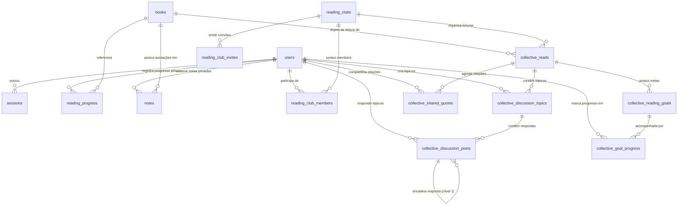

# Banco de Dados e Persistência do Lectoria

Este documento descreve o modelo de dados, o schema atual (versão 12), a política de integridade relacional, as regras de migração e os mecanismos de backup do **Lectoria**.

---

## 1. Princípios e Configuração do SQLite

O Lectoria utiliza **SQLite 3** como seu único banco de dados de produção:
- **Arquivo**: `data/lectoria.db` (configurável via `LECTORIA_DB_PATH`).
- **Modo WAL ativo**: `PRAGMA journal_mode = WAL;` permitindo múltiplos leitores concorrentes sem bloquear escritores.
- **Modo de sincronização equilibrado**: `PRAGMA synchronous = NORMAL;`.
- **Integridade referencial estrita**: `PRAGMA foreign_keys = ON;` executado obrigatoriamente a cada nova conexão aberta via `database.get_connection()`.
- **Modo de conexão**: Conexões dedicadas por operação (`row_factory = sqlite3.Row`) fechadas em blocos `try...finally`.

---

## 2. Visão do Schema e Entidades (Schema v12)

O schema está na **versão 12**, versionado pela tabela `schema_migrations`.

O código DDL completo e canônico reside em [database.py](file:///home/vini/Jellyfin%20livros/database.py).

### 2.1 Diagrama Entidade-Relacionamento (ERD)

---

## 3. Tabelas Introduzidas na v1.7.0 (Fase 1 / Schema v11)

As tabelas colaborativas da v1.7.0 foram criadas com restrições rigorosas de domínio e chaves estrangeiras:

### `collective_discussion_topics`
- **Finalidade**: Tópicos de discussão vinculados a uma leitura coletiva.
- **Campos Chave**:
  - `read_id TEXT NOT NULL REFERENCES collective_reads(id)`
  - `user_id INTEGER REFERENCES users(id) ON DELETE SET NULL`
  - `chapter_ref TEXT, page_start INTEGER, page_end INTEGER`
  - `is_pinned INTEGER DEFAULT 0, is_locked INTEGER DEFAULT 0`
  - `is_spoiler INTEGER DEFAULT 0, is_deleted INTEGER DEFAULT 0`
- **Índices**:
  - `idx_col_disc_topics_read ON collective_discussion_topics(read_id, is_pinned DESC, updated_at DESC)`
  - `idx_col_disc_topics_user ON collective_discussion_topics(user_id)`

### `collective_discussion_posts`
- **Finalidade**: Respostas encadeadas aos tópicos de discussão.
- **Campos Chave**:
  - `topic_id TEXT NOT NULL REFERENCES collective_discussion_topics(id)`
  - `parent_post_id TEXT REFERENCES collective_discussion_posts(id) ON DELETE SET NULL`
  - `user_id INTEGER REFERENCES users(id) ON DELETE SET NULL`
  - `is_spoiler INTEGER DEFAULT 0, is_deleted INTEGER DEFAULT 0`
- **Índices**:
  - `idx_col_disc_posts_topic ON collective_discussion_posts(topic_id, created_at ASC)`
  - `idx_col_disc_posts_parent ON collective_discussion_posts(parent_post_id)`
  - `idx_col_disc_posts_user ON collective_discussion_posts(user_id)`
- **Triggers de Integridade**:
  - `trg_col_disc_posts_parent_same_topic_ins` e `trg_col_disc_posts_parent_same_topic_upd`: Impedem que uma resposta aponte como `parent_post_id` uma postagem pertencente a outro tópico.

### `collective_reading_goals`
- **Finalidade**: Metas coletivas estabelecidas para os participantes da leitura.
- **Campos Chave**:
  - `read_id TEXT NOT NULL REFERENCES collective_reads(id)`
  - `target_date TEXT, target_page INTEGER, chapter_ref TEXT`
  - `display_order INTEGER DEFAULT 0, is_archived INTEGER DEFAULT 0`
- **Índices**:
  - `idx_col_goals_read ON collective_reading_goals(read_id, display_order ASC, target_date ASC)`

### `collective_goal_progress`
- **Finalidade**: Registro do progresso voluntário de um usuário em uma meta específica.
- **Campos Chave**:
  - `goal_id TEXT NOT NULL REFERENCES collective_reading_goals(id)`
  - `user_id INTEGER NOT NULL REFERENCES users(id) ON DELETE CASCADE`
  - `status TEXT CHECK (status IN ('pending', 'in_progress', 'completed'))`
  - `PRIMARY KEY (goal_id, user_id)`
- **Índices**:
  - `idx_col_goal_prog_user ON collective_goal_progress(user_id, status)`

### `collective_shared_quotes`
- **Finalidade**: Citações textuais compartilhadas voluntariamente na leitura.
- **Campos Chave**:
  - `read_id TEXT NOT NULL, book_id TEXT NOT NULL`
  - `FOREIGN KEY (read_id, book_id) REFERENCES collective_reads(id, book_id)` (garante que a citação pertença ao mesmo livro da leitura coletiva)
  - `user_id INTEGER REFERENCES users(id) ON DELETE SET NULL`
  - `quote_text TEXT NOT NULL (máximo de 1500 caracteres validado na aplicação)`
  - `epub_cfi TEXT, page_number INTEGER`
  - `is_spoiler INTEGER DEFAULT 0, is_deleted INTEGER DEFAULT 0`
- **Índices**:
  - `idx_col_quotes_read ON collective_shared_quotes(read_id, created_at DESC)`
  - `idx_col_quotes_book ON collective_shared_quotes(book_id)`

---

## 3.1 Evolução na v1.8.0 (Fase 1 / Schema v12 — Anotações Colaborativas e Marcadores)

A migração `_apply_migration_v12` evoluiu as tabelas de estudo do leitor sem perda de dados, garantindo que 100% dos registros existentes e novos nasçam com `visibility = 'private'`:

### Evolução de `highlights`
- `visibility TEXT NOT NULL DEFAULT 'private' CHECK (visibility IN ('private', 'public'))`
- `epub_cfi TEXT NULL` (localizador canônico `epubcfi(...)` para livros EPUB)
- `chapter_label TEXT NULL`
- `updated_at TIMESTAMP NULL`
- **Índices adicionados**:
  - `idx_highlights_book_vis_page ON highlights(book_id, visibility, page)`
  - `idx_highlights_book_user_page ON highlights(book_id, user_id, page)`
  - `idx_highlights_book_cfi ON highlights(book_id, epub_cfi)`

### Evolução de `notes`
- `visibility TEXT NOT NULL DEFAULT 'private' CHECK (visibility IN ('private', 'public'))`
- `epub_cfi TEXT NULL`
- `chapter_label TEXT NULL`
- **Índices adicionados**:
  - `idx_notes_book_vis_page ON notes(book_id, visibility, page)`
  - `idx_notes_book_user_page ON notes(book_id, user_id, page)`
  - `idx_notes_book_cfi ON notes(book_id, epub_cfi)`

### Evolução de `page_drawings`
- `visibility TEXT NOT NULL DEFAULT 'private' CHECK (visibility IN ('private', 'public'))`
- `created_at TIMESTAMP NULL`
- **Índices adicionados**:
  - `idx_drawings_book_vis_page ON page_drawings(book_id, visibility, page)`
  - `idx_drawings_book_user_page ON page_drawings(book_id, user_id, page)`

### Nova tabela `bookmarks` (Marcadores Pessoais de Leitura)
- **Finalidade**: Marcadores rápidos de página PDF ou posição EPUB CFI, estritamente privados por usuário.
- **Campos Chave**:
  - `id TEXT PRIMARY KEY`
  - `book_id TEXT NOT NULL REFERENCES books(id) ON DELETE CASCADE`
  - `user_id INTEGER NOT NULL REFERENCES users(id) ON DELETE CASCADE`
  - `page INTEGER NOT NULL DEFAULT 1 CHECK (page >= 1)`
  - `epub_cfi TEXT NULL, chapter_label TEXT NULL, label TEXT NOT NULL DEFAULT ''`
  - `created_at TIMESTAMP NOT NULL DEFAULT CURRENT_TIMESTAMP, updated_at TIMESTAMP NOT NULL DEFAULT CURRENT_TIMESTAMP`
- **Índices**:
  - `idx_bookmarks_book_user_page ON bookmarks(book_id, user_id, page)`
  - `uq_bookmarks_book_user_pos ON bookmarks(book_id, user_id, page, COALESCE(epub_cfi, ''))` (previne duplicação na mesma posição)

---

## 4. Política de Integridade e Preservação de Histórico

1. **Exclusão Lógica (*Soft Delete*)**:
   - Tópicos, respostas e citações utilizam a coluna `is_deleted INTEGER DEFAULT 0`.
   - Quando excluídos pelo autor ou por moderador, o conteúdo textual é marcado e substituído por placeholder neutro (`[Mensagem removida pelo autor/moderação]`), preservando o encadeamento e contexto das respostas subordinadas.
2. **Desassociação Segura de Usuários**:
   - Caso um usuário seja removido do sistema, seus tópicos, respostas e citações históricas recebem `ON DELETE SET NULL`, sem quebra de integridade e sem apagar os debates da comunidade.
3. **Imutabilidade em Leituras Históricas**:
   - O arquivamento de um clube de leitura (`reading_clubs.is_archived = 1`) ou a conclusão/cancelamento de uma leitura coletiva (`collective_reads.status IN ('completed', 'cancelled')`) **nunca apaga dados**.
   - Os registros continuam integralmente consultáveis para membros autorizados, com bloqueio no backend para novas inserções ou edições.

---

## 5. Procedimento de Migração e Rollback

As migrações são orquestradas automaticamente na inicialização da aplicação (`database.init_db()`):

1. **Backup Pré-Migração Seguro**:
   - Antes de aplicar o DDL da v11, o método `_apply_migration_v11` cria uma cópia física pré-migração em `backups/lectoria_pre_migration_v10_to_v11_<timestamp>.db.bak`.
   - Se o arquivo de destino já existir, um sufixo numérico ou timestamp é adicionado para **nunca sobrescrever um backup anterior**.
2. **Transação Atômica**:
   - Todas as instruções `CREATE TABLE`, `CREATE INDEX` e `CREATE TRIGGER` da migração são executadas dentro de uma transação explícita (`BEGIN ... COMMIT`).
   - Se ocorrer qualquer exceção durante a migração, um `ROLLBACK` completo é emitido, a versão em `schema_migrations` não é alterada e o banco permanece íntegro na versão 10.
3. **Idempotência**:
   - Cláusulas `IF NOT EXISTS` são usadas em todas as tabelas, índices e triggers. A verificação prévia da versão em `schema_migrations` evita reaplicações acidentais.
4. **Verificação de Chaves Estrangeiras**:
   - Após a migração, o teste automatizado executa `PRAGMA foreign_key_check;` para certificar que nenhum relacionamento foi violado.

---

## 6. Rotinas de Backup Online (`backup_service.py`)

- O Lectoria implementa a **SQLite Online Backup API** via módulo Python `sqlite3`, garantindo cópias íntegras mesmo sob concorrência de leitura e escrita (WAL).
- Um lock de processo (`threading.Lock`) protege a operação contra backups concorrentes.
- A CLI administrativa `scripts/backup.py` oferece comandos para:
  - `--backup`: Criar novo backup com timestamp.
  - `--verify`: Verificar integridade com `PRAGMA integrity_check`.
  - `--list`: Listar backups disponíveis.
  - `--prune N`: Reter apenas os N backups mais recentes (somente mediante solicitação explícita).
