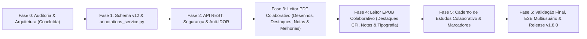

# Lectoria v1.8.0 — Roadmap de Implementação, Testes e Riscos

- **Versão Alvo**: `v1.8.0 — Reader Experience & Social Annotations`
- **Branch de Trabalho**: `feature/v1.8.0-reader-experience`
- **Modelo de Execução**: Fases incrementais, testáveis isoladamente e sujeitas a aprovação explícita a cada etapa.

---

## 1. Visão Geral das Fases de Implementação

---

## 2. Detalhamento das Fases, Entregáveis e Estimativa de Complexidade

### Fase 1 — Persistência SQLite (`v11 → v12`) e Camada de Serviço (`annotations_service.py`, `export_service.py`) — **CONCLUÍDA**
- **Complexidade**: Média | **Risco**: Baixo
- **Escopo**:
  1. Implementar `_apply_migration_v12(cursor)` em `database.py` elevando `SCHEMA_VERSION = 12`:
     - Adicionar `visibility` (`'private' | 'public'`, default `'private'`), `epub_cfi`, `chapter_label` e `updated_at` em `highlights` e `notes`.
     - Adicionar `visibility` (`'private' | 'public'`, default `'private'`) e `created_at` em `page_drawings`.
     - Criar tabela `bookmarks` (`id`, `book_id`, `user_id`, `page`, `epub_cfi`, `chapter_label`, `label`, `created_at`, `updated_at`) com índice único `uq_bookmarks_book_user_pos`.
     - Criar os índices compostos de performance.
  2. Evoluir `annotations_service.py`:
     - Suporte a `visibility` (sempre `'private'` por padrão), `epub_cfi` e `chapter_label`.
     - Consultas com filtro de escopo (`scope = 'mine' | 'public' | 'all_visible'`), retornando `author_display_name`, `author_avatar_color` e `is_own` via `JOIN` único com `users` e `user_profiles`.
     - Separação clara em `get_page_drawing`, `get_page_drawings` e `get_page_drawings_bundle(book_id, page, user_id)` retornando `own_drawing` e `public_drawings` (somente-leitura).
     - Funções de mudança de visibilidade (`set_highlight_visibility`, `set_note_visibility`, `set_page_drawing_visibility`) com validação estrita de autoria.
     - CRUD completo de `bookmarks`.
  3. Atualizar `export_service.py`:
     - Preservar `epub_cfi`, `chapter_label` e `bookmarks` na exportação/importação JSON e Markdown, garantindo que exportações incluam apenas `scope='mine'` e que itens importados nasçam sempre como `visibility = 'private'` vinculados ao usuário autenticado.
- **Critério de Aceite (Testes da Fase 1 — Aprovado)**:
  - Suíte `tests/test_v180_annotations_persistence_and_service.py` validando migração `v11 → v12`, preservação 100% privada de registros legados, rollback em falha injetada, isolamento de autoria, EPUB CFI, desenhos próprios/públicos, marcadores e exportação/importação.

---

### Fase 2 — API REST, Validação Pydantic e Segurança Anti-IDOR (`main.py`) — **CONCLUÍDA**
- **Complexidade**: Média | **Risco**: Baixo
- **Escopo**:
  1. Atualizar e criar os endpoints em `main.py` com `ConfigDict(extra="forbid")`:
     - `GET /api/books/{book_id}/annotations` (`scope`, `search`, `sort`, `epub_cfi`, `limit`, `offset`).
     - `GET /api/books/{book_id}/pages/{page}/annotations` (`scope`, `epub_cfi`, `search`, `sort`) e `GET /api/books/{book_id}/pages/{page}/drawing` (incluindo `own_drawing` e `public_drawings`).
     - `PATCH /api/books/{book_id}/highlights/{highlight_id}/visibility` (e `/api/highlights/{highlight_id}/visibility`)
     - `PATCH /api/books/{book_id}/notes/{note_id}/visibility` (e `/api/notes/{note_id}/visibility`)
     - `PATCH /api/books/{book_id}/pages/{page}/drawing/visibility`
     - `GET / POST / DELETE /api/books/{book_id}/bookmarks` (e `DELETE /api/bookmarks/{bookmark_id}`)
  2. Validação rigorosa de limites de payload (número de traços, pontos por traço, espessura, tamanho de texto, coordenadas e formato `epubcfi(...)`) diretamente nos modelos e endpoints REST.
- **Critério de Aceite (Testes da Fase 2 — Aprovado)**:
  - Nova suíte `tests/test_v180_annotations_api_security.py` cobrindo autenticação (`401`), CSRF (`403`), `extra="forbid"` (`422`), ciclo de vida de visibilidade (`private` → `public` → `private`), anti-IDOR entre múltiplos leitores, desenhos próprios/públicos, EPUB CFI, marcadores pessoais e compatibilidade retroativa v1.7.0.

---

### Fase 3 — Leitor PDF Colaborativo: Desenhos Compartilhados, Destaques, Notas na Página e Refinamentos (`reader.html`, `reader.js`, `style.css`) — **CONCLUÍDA**
- **Complexidade**: Alta | **Risco**: Médio
- **Escopo**:
  1. **Camada Dupla de Desenhos SVG (`viewBox="0 0 1000 ${vbHeight}"` isotrópico)**:
     - Adicionada `<svg class="public-drawing-layer">` (somente-leitura, `pointer-events: none`) abaixo de `<svg class="drawing-layer">` tanto no modo Página Única quanto nos slots do modo Rolagem Contínua.
     - Renderização vetorial isotrópica preservando uniformidade de espessura e alinhamento exato sob zoom (`0.4x–4.0x`), *Fit Width*, *Fit Page*, redimensionamento e orientação.
     - Botão de visibilidade do próprio desenho na `#drawing-toolbar` (**🔒 Privado** / **🌐 Público**) e selo discreto de autoria na página quando houver desenhos públicos de outros leitores.
  2. **Popover de Inspeção de Destaques e Indicadores de Notas na Página**:
     - Substituído o `window.confirm()` imediato ao clicar em `.highlight-box` por `#highlight-popover` exibindo texto, autor, nota vinculada autorizada, estado de visibilidade e ações permitidas conforme posse.
     - Renderizados pins discretos de notas na página (`.page-note-pins-layer`) com popover `#page-note-popover` e seletor explícito de visibilidade no modal `#modal-note-editor` com aviso na primeira publicação.
  3. **Controle de Ruído Visual de Camadas e Refinamentos PDF**:
     - Seletor de visualização no leitor (*Minhas + Públicas*, *Somente minhas*, *Ocultar anotações*) isolado por usuário no `localStorage`.
     - Corrigido o cálculo de `dockMargin` em `renderSlotPage()` para tablets no modo contínuo.
     - Ativado o modo marca-texto (`#btn-tool-highlight`) para destacar ao soltar a seleção e adicionada busca textual incremental no PDF (`#reader-search-bar` via `Ctrl+F` / `/`).
- **Critério de Aceite (Testes da Fase 3 — Aprovado)**:
  - Suíte `tests/e2e/test_v180_pdf_collaborative_e2e.py` validando os 20 cenários entre dois usuários (Alice e Bob) no Chromium headless em desktop e mobile.

---

### Fase 4 — Leitor EPUB Colaborativo: Destaques CFI, Notas e Tipografia (`reader.html`, `reader.js`, `style.css`) — **CONCLUÍDA**
- **Complexidade**: Alta | **Risco**: Médio
- **Escopo**:
  1. Habilitada `#selection-toolbar` (5 cores de destaque + botão Nota + botão Compartilhar no Clube quando aplicável) para **todos os livros EPUB**, independentemente de leitura coletiva.
  2. Integrado `epubRendition.annotations.highlight()` para renderizar destaques próprios e públicos via `epub_cfi`, diferenciando visualmente terceiros e abrindo `#highlight-popover` ao clicar.
  3. Garantido realinhamento automático após alterações de tamanho de fonte (`A-`/`A+`), família tipográfica, espaçamento entre linhas (`1.4`, `1.65`, `1.9`), margens (`compact`, `normal`, `wide`), tema e redimensionamento de viewport.
  4. Adicionados pins de notas no EPUB (`#epub-note-pins-layer`), navegação direta por `epub_cfi` com destaque temporário e fallback defensivo para CFIs inválidos/desatualizados.
- **Critério de Aceite (Testes da Fase 4 — Aprovado)**:
  - Suíte `tests/e2e/test_v180_epub_collaborative_e2e.py` validando os 20 cenários EPUB entre dois usuários (Alice e Bob) no Chromium headless em desktop e mobile, além de regressão zero da suíte PDF.

---

### Fase 5 — Caderno de Estudos Colaborativo e Marcadores (`reader.html`, `reader.js`, `style.css`) — **CONCLUÍDA**
- **Complexidade**: Média | **Risco**: Baixo
- **Escopo**:
  1. Evoluído `#annotations-drawer` com:
     - Seletor segmentado de escopo independente: **Minhas**, **Públicas**, **Todas visíveis**.
     - Abas de tipo: `Todas`, `Destaques`, `Notas`, `Desenhos`, `Marcadores` (sempre privados).
     - Ordenação por **Posição no livro** (com `compareEpubCfi` numérico no EPUB) ou **Mais recentes**, além de pesquisa com debounce, `AbortController` e `requestSeq`.
     - Paginação incremental (**Carregar mais**) com `has_more` e `total_counts`, além de exclusão/visibilidade de desenhos próprios na aba Desenhos.
  2. Adicionado botão de **Marcador Rápido (Bookmark)** (`#btn-toggle-bookmark`, atalho `k` e item no menu mobile) integrado aos endpoints `/api/books/{book_id}/bookmarks`.
- **Critério de Aceite (Testes da Fase 5 — Aprovado)**:
  - Suíte `tests/e2e/test_v180_study_notebook_bookmarks_e2e.py` validando os 25 cenários de escopos, filtros, pesquisa, ordenação, paginação (> 50 itens), marcadores PDF/EPUB, privacidade e mobile (`390px`).

---

### Fase 6 — Validação Final, Hardening, Documentação e Preparação da Release v1.8.0 — **CONCLUÍDA**
- **Complexidade**: Média | **Risco**: Baixo
- **Escopo**:
  1. Estabilização de testes determinísticos (`test_audit_v140.py`), auditoria de migração SQLite v12, segurança multiusuário (Alice/Bob/Charlie), geometria PDF, ordenação CFI (`compareEpubCfi`), responsividade em 7 resoluções (`360px–1920px`) e regressão v1.7.0.
  2. Alinhamento de versão para `1.8.0`, atualização de `AGENTS.md`, `README.md`, `CHANGELOG.md` e criação de `docs/v1.8.0-validation-report.md`, `docs/v1.8.0-release-readiness.md` e `docs/v1.8.0-deployment-plan.md`.

---

## 3. Plano Completo de Testes e Validação

| Categoria | Cenários Obrigatórios |
| :--- | :--- |
| **Migração v11 → v12** | Preservação de 100% dos destaques, notas e desenhos antigos como `visibility = 'private'`; backup pré-migração único; rollback completo em falha injetada; `PRAGMA foreign_key_check`. |
| **Privacidade e Ciclo de Vida** | Criação privada por padrão; publicação explícita (`private → public`); revogação imediata (`public → private`); importação JSON mantendo itens importados como `private`. |
| **Autorização e Anti-IDOR** | Bloqueio de leitura de anotação privada alheia (`404`); bloqueio de edição/exclusão/mudança de visibilidade de anotação ou desenho alheio (`403/404`); bloqueio de acesso se o livro estiver ausente ou em fonte inativa. |
| **Desenhos Compartilhados (PDF)** | Dois usuários desenhando na mesma página; isolamento entre `.public-drawing-layer` e `.drawing-layer`; borracha e "Limpar Página" afetando apenas os próprios traços; invariância sob zoom (`0.5x`, `1.0x`, `2.0x`), *Fit Width*, *Fit Page* e redimensionamento de janela. |
| **EPUB CFI Colaborativo** | Destaque e nota em EPUB por `cfiRange`; visibilidade pública entre dois leitores; navegação pelo Caderno de Estudos até o CFI; mudança de fonte (`100% → 140%`) sem perda do destaque; fallback seguro para CFI inválido. |
| **Caderno de Estudos e Mobile** | Alternância entre *Minhas*, *Públicas* e *Todas as visíveis*; contadores exatos; busca textual; ordenação por posição e data; ausência de overflow horizontal (`320px`, `360px`, `375px`, `768px`, `1280px`, `1920px`). |

---

## 4. Riscos Técnicos Identificados e Mitigações

| Risco | Severidade | Mitigação Projetada |
| :--- | :---: | :--- |
| **1. Deslocamento de desenhos PDF ao alterar zoom ou resolução de tela** | Alta | Usar `viewBox="0 0 1000 1000"` + `preserveAspectRatio="none"` nos elementos `<svg>` de desenho, mapeando coordenadas normalizadas `[0..1]` para `[0..1000]` de forma determinística e independente do DPI/viewport. |
| **2. Sobrecarga de payload se muitos usuários desenharem em várias páginas de um PDF** | Média | Não enviar `strokes_json` no resumo geral `/api/books/{id}/annotations`; carregar `strokes_json` apenas para a página visível (ou slots visíveis no `IntersectionObserver`) via `/api/books/{id}/pages/{page}/drawing`. |
| **3. Instabilidade de desenhos livres sobre texto reflowable no EPUB** | Alta | Não usar coordenadas de tela `(x, y)` sobre texto reflowable no EPUB; utilizar destaques e notas ancorados por `epub_cfi` via `epubRendition.annotations`, mantendo o desenho livre de página inteira exclusivo para páginas fixas PDF. |
| **4. Exposição acidental de dados privados do usuário ao exibir autoria pública** | Alta | Projetar a query SQL para selecionar estritamente `u.id`, `COALESCE(up.display_name, u.display_name, u.username) AS author_display_name` e `up.avatar_color`, nunca retornando colunas sensíveis de `users`. |
| **5. Poluição visual em páginas muito anotadas por vários leitores** | Média | Implementar o controle de camadas no leitor (*Somente minhas*, *Minhas + Públicas*, *Ocultar tudo*) + filtro por autor nos desenhos públicos da página. |
