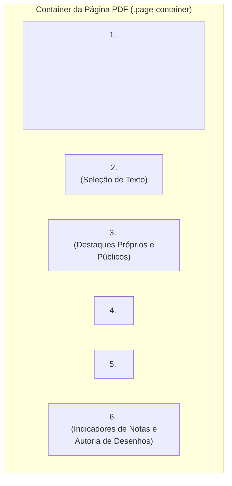

# Lectoria v1.8.0 — Arquitetura de Anotações Colaborativas e Experiência do Leitor

- **Versão Alvo**: `v1.8.0`
- **Evolução de Schema Proposta**: `v11 → v12`
- **Princípio Norteador**: *"Privado por padrão, colaborativo por escolha explícita, leve em qualquer hardware."*

---

## 1. Fronteira Conceitual: Anotações no Livro (v1.8.0) vs. Citações de Clube (v1.7.0) vs. Mural Social (v1.5.0)

Para preservar a coesão arquitetural do Lectoria, a v1.8.0 distingue claramente três mecanismos complementares:

| Dimensão | Anotações no Livro (v1.8.0 — Novo) | Citações da Leitura Coletiva (v1.7.0) | Mural "Nossa Biblioteca" (v1.5.0) |
| :--- | :--- | :--- | :--- |
| **Onde vive** | Diretamente nas páginas do livro (`reader.html` + Caderno de Estudos) | Dentro de uma Leitura Coletiva de um Clube (`shared_reading.js`) | Na aba social comunitária da biblioteca (`index.html`) |
| **Tabelas SQLite** | `highlights`, `notes`, `page_drawings` (+ `bookmarks`) | `collective_shared_quotes` | `shared_annotations`, `annotation_comments` |
| **Tipos suportados** | Destaques (`rects` / `epub_cfi`), Notas vinculadas/avulsas e **Desenhos vetoriais de página (`strokes`)** | Citação textual + comentário opcional | Citação textual + comentário opcional |
| **Ciclo de Vida** | Dinâmico (*live*): o autor pode alternar entre `private` e `public` a qualquer momento no leitor | *Snapshot* publicado voluntariamente em uma leitura coletiva ativa | *Snapshot* publicado no mural geral |
| **Integração** | Uma nota/destaque do leitor continua podendo ser enviada como citação para uma leitura coletiva (v1.7.0) | Botão *"Abrir no leitor"* leva exatamente à página/CFI da obra | Exibe destaques públicos consentidos |

---

## 2. Modelo de Visibilidade e Permissões (As 10 Regras Fundamentais)

Cada registro em `highlights`, `notes` e `page_drawings` passa a possuir um atributo explícito `visibility`:

- **`private` (Padrão Absoluto)**:
  - Visível exclusivamente ao próprio autor (`user_id == current_user.id`).
  - **100% das anotações, destaques e desenhos já existentes no banco (v1.0.0–v1.7.0) permanecem `private`** na migração v12.
  - Toda nova anotação, destaque ou desenho criado nasce como `private`, salvo quando o leitor aciona explicitamente o controle de publicação.
- **`public` (Compartilhada no Livro)**:
  - Visível a qualquer usuário autenticado da instância que possua acesso legítimo ao livro (`resolve_book_file_for_user` / fonte ativa).
  - Exibe o `display_name` e `avatar_color` públicos do autor (via `user_profiles` / `users`), **nunca** expondo credenciais, e-mail, hash de sessão ou configurações privadas.
  - Estritamente **somente-leitura** para outros leitores: terceiros podem visualizar no livro e no Caderno de Estudos, mas jamais editar, apagar com borracha ou alterar sua visibilidade.
- **Decisão Aprovada sobre Visibilidade**:
  - Implementar exclusivamente `private` e `public` (`CHECK (visibility IN ('private', 'public'))`).
  - Não implementar a modalidade `club` nem criar a coluna `club_id` preventivamente sem necessidade concreta.
  - A associação e autorização utilizam estritamente o identificador canônico do livro (`books.id`), sem agrupamento automático por título, autor, nome de arquivo ou ISBN.

### 2.1 Matriz de Autorização de Anotações no Livro (v1.8.0)

| Operação | Sem Sessão | Leitor sem Acesso ao Livro* | Autor da Anotação | Outro Leitor Autenticado | Admin da Instância |
| :--- | :---: | :---: | :---: | :---: | :---: |
| Ler anotação `private` | `401` | `404` | `200 OK` | **`404 Not Found`** (Anti-IDOR) | **`404 Not Found`** (Privacidade estrita) |
| Ler anotação `public` | `401` | `404` | `200 OK` | `200 OK` | `200 OK` |
| Criar destaque / nota / desenho (`private` padrão) | `401` | `404` | `201 Created` | — | — |
| Alterar visibilidade (`private` ↔ `public`) | `401` | `404` | `200 OK` | **`403/404`** | `200 OK` (apenas despublicar `public → private` por moderação) |
| Editar conteúdo de nota ou traços de desenho | `401` | `404` | `200 OK` | **`403/404`** | **`403/404`** (Admin não edita autoria alheia) |
| Excluir destaque / nota / desenho | `401` | `404` | `200 OK` | **`403/404`** | `200 OK` (apenas se `visibility == 'public'`, por moderação) |

*\*Livro inexistente, `is_missing = 1` ou pertencente a fonte desativada (`library_sources.is_active = 0`).*

---

## 3. Evolução do Banco de Dados: Migração SQLite `v11 → v12`

### 3.1 Princípios da Migração v12
1. **Zero perda de dados e zero reconstrução destrutiva**: Uso exclusivo de `ALTER TABLE ... ADD COLUMN` com valores `DEFAULT 'private'` e `CREATE TABLE IF NOT EXISTS` / `CREATE INDEX IF NOT EXISTS`.
2. **Backup pré-migração obrigatório**: Mantém o mecanismo já homologado em `database.init_db()` que cria `lectoria_pre_migration_v11_to_v12.db.bak` (com sufixo único sem sobrescrita) e valida `PRAGMA integrity_check` antes e depois.
3. **Transação atômica**: Se qualquer instrução falhar, `conn.rollback()` restaura o estado exato da v11.

### 3.2 DDL Proposto para `_apply_migration_v12(cursor)`

```sql
-- 1. Evolução da tabela highlights (suporte a visibilidade e EPUB CFI)
ALTER TABLE highlights ADD COLUMN visibility TEXT NOT NULL DEFAULT 'private'
    CHECK (visibility IN ('private', 'public'));
ALTER TABLE highlights ADD COLUMN epub_cfi TEXT;
ALTER TABLE highlights ADD COLUMN chapter_label TEXT;
ALTER TABLE highlights ADD COLUMN updated_at TIMESTAMP;

-- 2. Evolução da tabela notes (suporte a visibilidade e EPUB CFI)
ALTER TABLE notes ADD COLUMN visibility TEXT NOT NULL DEFAULT 'private'
    CHECK (visibility IN ('private', 'public'));
ALTER TABLE notes ADD COLUMN epub_cfi TEXT;
ALTER TABLE notes ADD COLUMN chapter_label TEXT;

-- 3. Evolução da tabela page_drawings (suporte a visibilidade e data de criação)
ALTER TABLE page_drawings ADD COLUMN visibility TEXT NOT NULL DEFAULT 'private'
    CHECK (visibility IN ('private', 'public'));
ALTER TABLE page_drawings ADD COLUMN created_at TIMESTAMP;

-- 4. Nova tabela leve para Marcadores de Página/Posição (Bookmarks pessoais do leitor)
CREATE TABLE IF NOT EXISTS bookmarks (
    id TEXT PRIMARY KEY,
    book_id TEXT NOT NULL REFERENCES books(id) ON DELETE CASCADE,
    user_id INTEGER NOT NULL REFERENCES users(id) ON DELETE CASCADE,
    page INTEGER NOT NULL DEFAULT 1 CHECK (page >= 1),
    epub_cfi TEXT NULL,
    chapter_label TEXT NULL,
    label TEXT NOT NULL DEFAULT '',
    created_at TIMESTAMP NOT NULL DEFAULT CURRENT_TIMESTAMP,
    updated_at TIMESTAMP NOT NULL DEFAULT CURRENT_TIMESTAMP
);

-- 5. Índices compostos para consultas filtradas por livro, página e visibilidade (Zero N+1)
CREATE INDEX IF NOT EXISTS idx_highlights_book_vis_page ON highlights(book_id, visibility, page);
CREATE INDEX IF NOT EXISTS idx_highlights_book_user_page ON highlights(book_id, user_id, page);
CREATE INDEX IF NOT EXISTS idx_highlights_book_cfi ON highlights(book_id, epub_cfi);

CREATE INDEX IF NOT EXISTS idx_notes_book_vis_page ON notes(book_id, visibility, page);
CREATE INDEX IF NOT EXISTS idx_notes_book_user_page ON notes(book_id, user_id, page);
CREATE INDEX IF NOT EXISTS idx_notes_book_cfi ON notes(book_id, epub_cfi);

CREATE INDEX IF NOT EXISTS idx_drawings_book_vis_page ON page_drawings(book_id, visibility, page);
CREATE INDEX IF NOT EXISTS idx_drawings_book_user_page ON page_drawings(book_id, user_id, page);

CREATE INDEX IF NOT EXISTS idx_bookmarks_book_user_page ON bookmarks(book_id, user_id, page);
CREATE UNIQUE INDEX IF NOT EXISTS uq_bookmarks_book_user_pos ON bookmarks(book_id, user_id, page, COALESCE(epub_cfi, ''));
```

### 3.3 Estratégia de Rollback da Migração v12
- Como a migração v12 apenas adiciona colunas com `DEFAULT` nas tabelas `highlights`, `notes` e `page_drawings` e cria a tabela `bookmarks`, em caso de necessidade de rollback em produção basta seguir o procedimento padrão de restauração via `python3 scripts/backup.py --restore lectoria_pre_migration_v11_to_v12.db.bak`.

---

## 4. Arquitetura de Desenhos Compartilhados no PDF



### 4.1 Separação Estrita de Camadas SVG (Própria vs. Pública)
1. **Camada de Desenhos Públicos de Terceiros (`<svg class="public-drawing-layer">`)**:
   - Posicionada abaixo da camada de desenho do próprio usuário, com `pointer-events: none` durante a leitura e durante o uso da caneta/borracha.
   - Renderiza os traços de `page_drawings` onde `book_id = :book_id AND page = :page AND visibility = 'public' AND user_id != :current_user_id`.
   - **Imune à borracha e ao botão "Limpar Página"**: A borracha geométrica (`eraseStrokesAtPoint`) e o botão `DELETE /api/books/{id}/pages/{page}/drawing` operam exclusivamente sobre `pageStrokesMap` do `current_user.id`.
2. **Camada de Desenho do Próprio Usuário (`<svg class="drawing-layer">`)**:
   - Renderiza e edita apenas os traços pertencentes ao próprio leitor autenticado (`user_id == current_user.id`).
   - Na barra `#drawing-toolbar`, um botão de alternância explícito (**🔒 Privado** / **🌐 Público na Página**) permite ao autor definir se o seu desenho naquela página está privado ou visível para outros leitores, acionando `PATCH /api/books/{id}/pages/{page}/drawing/visibility`.

### 4.2 Invariância de Escala, Zoom e Resolução (`viewBox="0 0 1000 1000"`)
- Todas as coordenadas de pontos `pt.x` e `pt.y` continuam armazenadas no banco no intervalo normalizado `[0.0, 1.0]` (100% compatível com todos os desenhos existentes da v1.0.0–v1.7.0 e com a exportação/importação JSON).
- Na renderização SVG:
  - Configura-se `svgElement.setAttribute("viewBox", "0 0 1000 1000")` e `svgElement.setAttribute("preserveAspectRatio", "none")`.
  - Cada coordenada normalizada `(x, y)` é mapeada para `(x * 1000, y * 1000)` e a espessura `stroke-width` (`2`, `4`, `8`) é expressa diretamente no espaço de coordenadas `1000x1000`.
  - **Resultado**: Quando o usuário aplica zoom (`0.5x` a `4.0x`), alterna entre *Fit Width* e *Fit Page* ou redimensiona a janela/rotaciona o tablet, o navegador reescala o SVG vetorialmente em hardware com **zero deslocamento e zero necessidade de recalcular caminhos em JavaScript**.

### 4.3 Identificação Discreta de Autoria dos Desenhos na Página
Para permitir identificar quem criou um desenho público sem poluir a leitura:
- Quando uma página possui desenhos públicos de outros leitores (e a camada pública está ativa), exibe-se um **selo compacto de autoria** no canto superior direito da margem da página (ex.: `🎨 Desenhos de: Ana, Marcos` com as cores de seus avatares).
- Ao passar o mouse ou tocar no nome de um autor no selo (ou no item correspondente dentro do Caderno de Estudos), os traços daquele autor na camada `.public-drawing-layer` recebem um realce suave (`filter: drop-shadow(...)`), e um checkbox rápido permite ocultar/mostrar os traços daquele autor específico na sessão.

---

## 5. Arquitetura de Anotações Compartilhadas no EPUB

### 5.1 Destaques e Notas Ancorados por EPUB CFI
1. **Seleção de Texto em Qualquer EPUB**:
   - O evento `epubRendition.on("selected", (cfiRange, contents) => ...)` passa a funcionar para **todos os livros EPUB** (independentemente de pertencerem a uma leitura coletiva).
   - A barra `#selection-toolbar` exibe as 5 cores de destaque, o botão **Nota** e (se houver leitura coletiva elegível) o botão **Compartilhar na Leitura Coletiva**.
   - As coordenadas da barra flutuante são calculadas somando o `getBoundingClientRect()` do iframe do EPUB com o retângulo da seleção dentro de `contents.window`, aplicando o *clamping* horizontal seguro para telas móveis (`320px+`).
2. **Persistência e Renderização via `epubRendition.annotations`**:
   - Ao criar um destaque no EPUB, o frontend envia `POST /api/books/{id}/highlights` com `epub_cfi: cfiRange`, `page: currentPage` (porcentagem estimada `1..100` para ordenação aproximada), `selected_text`, `color` e `chapter_label`.
   - O leitor registra cada destaque visível (próprio ou público, conforme o filtro de camada ativo) usando `epubRendition.annotations.highlight(h.epub_cfi, { id: h.id }, onClickCallback, className, styles)`.
   - Quando o usuário altera o tamanho da fonte (`A-`/`A+`), muda a família tipográfica ou redimensiona a janela, o próprio EPUB.js reposiciona os SVGs de destaque acompanhando o *reflow* do texto.
3. **Tratamento Defensivo de CFIs Inválidos ou Desatualizados**:
   - Toda chamada a `epubRendition.annotations.highlight(cfi, ...)` e `epubRendition.display(cfi)` é envolvida em `try / catch`. Se um CFI não puder ser resolvido no DOM do capítulo, a anotação permanece acessível textualmente no Caderno de Estudos sem lançar exceções não tratadas.

---

## 6. Controle de Ruído Visual Diretamente no Leitor

O leitor terá um controle rápido de visibilidade de camadas no cabeçalho (e no Bottom Sheet mobile), permitindo escolher entre 3 modos de visualização na página:

1. **Somente Minhas Anotações (`mine`)**: Renderiza na página apenas os destaques, notas e desenhos do próprio usuário autenticado.
2. **Minhas + Públicas (`all_visible` — Padrão quando colaborativo)**: Renderiza na página as anotações do próprio usuário e as anotações públicas da comunidade (diferenciadas por borda tracejada sutil e badge de autor no popover).
3. **Leitura Limpa / Ocultar Tudo (`hidden`)**: Oculta temporariamente todas as camadas visuais (`.highlights-layer`, `.drawing-layer`, `.public-drawing-layer`, `.page-note-pins-layer`) para leitura imersiva sem distrações.

> **Garantia**: Alterar esse seletor modifica apenas o estado visual do leitor (`localStorage.getItem("lectoria_layer_view_mode")`), **jamais** alterando a coluna `visibility` persistida no banco de dados.

---

## 7. Evolução do Caderno de Estudos Colaborativo (`#annotations-drawer`)

### 7.1 Filtros de Autoria / Escopo e Tipo
No topo do `#annotations-drawer`, abaixo da barra de pesquisa:
- **Seletor Segmentado de Escopo (`scope`)**:
  - **Minhas** (`mine`): todas as anotações do próprio usuário (privadas + públicas).
  - **Públicas** (`public`): todas as anotações públicas do livro (de outros leitores e próprias).
  - **Todas Visíveis** (`all_visible`): união das anotações privadas do usuário com todas as públicas do livro.
- **Abas de Tipo**:
  - `Todas`, `Destaques`, `Notas`, `Desenhos`, `Marcadores`.
- **Ordenação**:
  - Por **Posição no Livro** (`page ASC, created_at ASC`) ou **Mais Recentes** (`created_at DESC`).

### 7.2 Cartão de Anotação e Identificação do Autor
Cada item exibido no Caderno de Estudos apresenta:
- **Cabeçalho**:
  - Badge do tipo (*Destaque*, *Nota*, *Desenho*, *Marcador*).
  - Badge do autor: para itens de outros usuários, exibe avatar colorido com inicial + `author_display_name` (ex.: `🟣 Marina Costa`); para itens próprios, exibe `Você` + badge clicável de visibilidade (`🔒 Privada` ou `🌐 Pública`).
  - Localizador (`Pág. 42` no PDF ou `Cap. 3 · 28%` no EPUB) e data formatada.
- **Ações por Item**:
  - **Se `is_own == true`**: botão rápido **Tornar Pública / Tornar Privada**, **Editar** (para notas), **Adicionar Nota** (para destaques), **Compartilhar no Clube** (se houver leitura coletiva ativa) e **Excluir**.
  - **Se `is_own == false`**: apenas ação de navegação (**Ir para a Página / Posição**), sem botões de edição ou exclusão (exceto para `admin` moderando conteúdo público).

---

## 8. Contratos da API REST e Segurança

### 8.1 Endpoints Evoluídos e Novos (`main.py`)

| Método e Rota | Descrição e Parâmetros |
| :--- | :--- |
| `GET /api/books/{book_id}/annotations` | Suporta query params: `scope=mine\|public\|all_visible` (default `all_visible`), `page: Optional[int]`, `type: Optional[str]`, `search: Optional[str]`, `sort=position\|recent`, `limit: int = 200`, `offset: int = 0`. Retorna `highlights`, `notes`, `drawing_pages`, `bookmarks` e `counts` consistentes. |
| `GET /api/books/{book_id}/pages/{page}/annotations` | Retorna destaques, notas e desenhos (próprios + públicos, separados em `own_drawing` e `public_drawings`) para uma página específica sob demanda. |
| `POST /api/books/{book_id}/highlights` | Aceita `page`, `color`, `rects` (opcional se `epub_cfi` presente), `epub_cfi`, `chapter_label`, `selected_text`, `text_context`, `visibility: Literal['private', 'public'] = 'private'`. |
| `PATCH /api/books/{book_id}/highlights/{highlight_id}/visibility` | Alterna `visibility` (`'private'` ou `'public'`) de um destaque pertencente ao usuário autenticado. |
| `POST /api/books/{book_id}/notes` | Aceita `page`, `epub_cfi`, `chapter_label`, `content`, `color`, `highlight_id`, `visibility: Literal['private', 'public'] = 'private'`. |
| `PUT /api/books/{book_id}/notes/{note_id}` | Atualiza `content`, `color` e opcionalmente `visibility` da própria nota. |
| `PATCH /api/books/{book_id}/notes/{note_id}/visibility` | Alterna `visibility` (`'private'` ou `'public'`) da própria nota. |
| `PUT /api/books/{book_id}/pages/{page}/drawing` | Salva `strokes` e opcionalmente `visibility` (`'private'` padrão) do desenho do usuário na página. |
| `PATCH /api/books/{book_id}/pages/{page}/drawing/visibility` | Alterna `visibility` (`'private'` ou `'public'`) do desenho do próprio usuário na página `page`. |
| `GET /api/books/{book_id}/bookmarks` | Lista marcadores privados do usuário autenticado para o livro. |
| `POST /api/books/{book_id}/bookmarks` | Cria marcador rápido na página/CFI atual. |
| `DELETE /api/books/{book_id}/bookmarks/{bookmark_id}` | Remove marcador do próprio usuário. |

### 8.2 Controles de Segurança e Validação
- **Modelos Pydantic Estritos**: Todos os payloads de entrada utilizam `ConfigDict(extra="forbid")`.
- **Limites Anti-DoS**:
  - `selected_text <= 5000` caracteres; `content <= 10000` caracteres; `rects <= 100` retângulos por destaque; `strokes <= 500` traços por página e `points <= 5000` pontos por traço; coordenadas `x, y` validadas em `[-0.5, 1.5]`.
- **Cascata de Privacidade**: Se um destaque público tiver sua visibilidade revertida para `private`, qualquer nota vinculada a ele permanece privada ou, se pública, continua exibindo apenas o seu próprio contexto sem expor objetos privados de terceiros.
- **Prevenção de XSS**: Todo texto de destaque, nota, capítulo e `display_name` de autor é escapado com `escapeHtml()` antes de inserção no DOM; cores (`color`) são validadas contra regex hexadecimal/paleta permitida (`^#[0-9a-fA-F]{3,8}$`).
- **Importação Segura**: Ao importar um arquivo JSON de estudos (`apply_import_annotations`), todos os itens importados são gravados como `visibility = 'private'` por padrão, impedindo publicação em massa acidental.

---

## 9. Orçamento de Desempenho (Hardware Modesto / VPS 4 GB RAM)

1. **Zero Consultas N+1**:
   - As listagens de `highlights`, `notes` e `page_drawings` fazem um único `LEFT JOIN users u ON ... LEFT JOIN user_profiles up ON ...` utilizando os novos índices compostos `(book_id, visibility, page)` e `(book_id, user_id, page)`.
2. **Carregamento Sob Demanda de Traços Vetoriais (`strokes_json`)**:
   - O endpoint de resumo `GET /api/books/{book_id}/annotations` **não trafega o array pesado `strokes_json`** de todas as páginas do livro: ele retorna apenas os metadados leves `drawing_pages` (`page`, `user_id`, `author_display_name`, `visibility`, `updated_at`).
   - Os vetores `strokes_json` são buscados **somente para a página visível** via `GET /api/books/{book_id}/pages/{page}/drawing` (com cache em memória `pageStrokesMap` e `publicPageStrokesMap` invalidado ao trocar visibilidade ou editar).
3. **Virtualização Mantida no Modo Contínuo**:
   - Em PDFs de 500+ páginas, apenas os slots intersectando o viewport (`rootMargin: "300px"`) instanciam elementos `<canvas>` e `<svg class="public-drawing-layer">`. Quando a página sai de vista, `unloadSlotPage()` destrói o DOM pesado mantendo a memória RAM do navegador baixa e constante.
