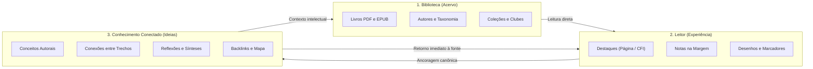

# Visão de Produto — Lectoria v1.9.0: Conhecimento Conectado

- **Versão Planejada**: `v1.9.0 — Conhecimento Conectado (Connected Knowledge)`
- **Branch de Planejamento**: `feature/v1.9.0-connected-knowledge`
- **Natureza do Documento**: Visão conceitual de produto, posicionamento, princípios inegociáveis e limites de identidade da Lectoria.

---

## 1. ATríade Fundamental da Lectoria

A proposta de produto da **Lectoria v1.9.0** parte de uma distinção estrutural clara entre três dimensões do trabalho intelectual com livros:

1. **Uma biblioteca organiza livros**: cataloga obras, autores, edições, formatos (PDF e EPUB), capas, categorias editoriais e estado de leitura (*Não iniciado*, *Em andamento*, *Concluído*).
2. **Um leitor organiza a experiência de leitura**: oferece tipografia confortável, paginação fluida, rolagem virtualizada, marca-texto preciso, notas na margem, desenhos vetoriais e marcadores de posição.
3. **Um ambiente de conhecimento conectado organiza as ideias que emergem dessas leituras**: permite nomear conceitos recorrentes entre diferentes obras, estabelecer relações explícitas entre passagens de livros distintos, redigir sínteses e reflexões autorais e rastrear a genealogia de cada ideia até a página ou parágrafo original que a fundamentou.

Até a versão `1.8.0`, a Lectoria consolidou com excelência as duas primeiras dimensões e a colaboração sobre o livro. Todavia, as anotações de cada livro ainda vivem em **silos isolados por obra**: uma nota escrita em *Vigiar e Punir* não consegue dialogar diretamente com um destaque em *A Sociedade do Espetáculo*, e um conceito estudado ao longo de dez livros diferentes não possui um lugar próprio onde o leitor possa acompanhar sua evolução.

A **v1.9.0 — Conhecimento Conectado** une essas três dimensões sem descaracterizar a Lectoria.

---

## 2. O Diferencial da Lectoria: Conhecimento Enraizado na Fonte

Ferramentas genéricas de notas em rede (como editores Markdown independentes ou wikis pessoais) tratam o livro como um elemento externo: o usuário precisa copiar trechos manualmente para fora do leitor, perdendo o vínculo vivo com a página, o contexto visual do capítulo, a tipografia original e a possibilidade de reabrir o livro diretamente no parágrafo citado.

Por outro lado, leitores digitais tradicionais prendem as notas dentro de cada arquivo individual: ao fechar o livro, as ideias ali anotadas desaparecem dentro daquele volume.

**O diferencial central da Lectoria v1.9.0 é que o conhecimento nasce diretamente do ato de ler e permanece indissociavelmente ligado à fonte original**:

- Todo destaque continua ancorado à sua coordenada normalizada na página PDF (`#page=N`) ou ao seu fragmento canônico EPUB (`#cfi=epubcfi(...)`).
- Todo conceito pode ser criado ou vinculado sem sair da página que está sendo lida.
- Toda relação entre ideias liga passagens reais de livros reais do acervo.
- Toda reflexão autoral preserva links diretos de um clique para abrir o leitor exatamente no trecho que lhe deu origem.

---

## 3. O Que a Lectoria v1.9.0 NÃO Deve Ser (Fronteiras de Identidade)

Para preservar a sobriedade estética editorial e a leveza técnica do projeto, a v1.9.0 estabelece limites explícitos:

1. **Não é um clone do Notion ou editor genérico de documentos empresariais**:
   - Não haverá bancos de dados arbitrários com dezenas de propriedades customizadas, quadros Kanban, calendários de tarefas, blocos arrastáveis complexos ou edição colaborativa em tempo real estilo Google Docs.
2. **Não é um clone pesado do Obsidian cheio de plugins**:
   - O usuário não precisará aprender dezenas de sintaxes proprietárias, configurar pastas locais de arquivos soltos nem gerenciar conflitos de sincronização para usar o sistema.
3. **Não depende de Inteligência Artificial comercial, LLMs ou bancos vetoriais**:
   - O conhecimento na Lectoria é **construído conscientemente pelo leitor**, não gerado automaticamente por modelos opacos. O sistema funciona 100% offline/auto-hospedado em SQLite puro, sem chaves de API externas, sem embeddings e sem consumo de GPU/RAM.
4. **Não sacrifica o desempenho do leitor**:
   - Abrir um PDF ou EPUB e folhear páginas deve continuar tão rápido na v1.9.0 quanto na v1.8.0. As camadas de conhecimento são carregadas sob demanda, nunca bloqueando a renderização da página.

---

## 4. Os 10 Princípios Diretores da v1.9.0

| # | Princípio | Tradução Arquitetural e de Produto |
| :-: | :--- | :--- |
| **1** | **Conhecimento construído pelo usuário** | Cada conceito, vínculo semântico e reflexão nasce de uma escolha deliberada do leitor durante ou após a leitura. |
| **2** | **Preservação das fontes originais** | Nenhuma anotação perde sua âncora bibliográfica (`book_id`, `page`, `epub_cfi`, `chapter_label`, `selected_text`). Os arquivos PDF/EPUB permanecem estritamente intocados (`read-only`). |
| **3** | **Relações explícitas entre ideias** | Em vez de apenas agrupar itens em pastas genéricas, o leitor pode expressar *como* uma ideia se relaciona a outra (*complementa*, *contradiz*, *exemplifica*, *fundamenta*, *desenvolve*, *questiona*). |
| **4** | **Privacidade por padrão** | Todo conceito, reflexão, trilha e conexão pessoal nasce `private` (`user_id` isolado). O grafo intelectual pessoal de um leitor jamais é exposto a terceiros sem ação explícita. |
| **5** | **Independência de serviços externos** | Zero dependência de nuvens de terceiros, CDNs externas, servidores de grafos ou APIs comerciais. Tudo roda localmente no contêiner Python + SQLite. |
| **6** | **Portabilidade dos dados** | O trabalho intelectual pertence ao leitor: tudo pode ser exportado em formatos abertos, legíveis e duráveis (Markdown com referências, JSON estruturado, pacote ZIP). |
| **7** | **Baixo consumo de recursos** | Projetado para operar confortavelmente em VPS compartilhada de 4 GB de RAM e mini-PCs domésticos modestos, usando índices SQLite compostos, paginação e consultas com limite estrito de profundidade. |
| **8** | **Simplicidade visual e estética editorial** | Interface limpa, tipográfica, silenciosa e coerente com os temas *Obsidiana*, *Papel Marfim* e *Sépia*. Ferramentas avançadas permanecem discretas até serem acionadas. |
| **9** | **Integração fluida com o leitor existente** | Associar um conceito ou conectar duas notas durante a leitura exige poucos cliques no popover contextual já familiar da v1.8.0, sem poluir a barra superior do leitor. |
| **10** | **Acessibilidade e navegabilidade textual** | Toda visualização gráfica (como o Mapa de Conhecimento) possui equivalente textual estruturado (listas de conexões, backlinks e índices navegáveis por teclado e leitores de tela). |

---

## 5. Objetivos Estratégicos da Versão 1.9.0

1. **Superar a fragmentação entre livros**: Permitir que o estudo de um tema transversal (ex.: *Técnica*, *Liberdade*, *Cálculo Diferencial*, *Modernismo*) reúna evidências de quantos livros forem necessários.
2. **Transformar anotações passivas em repertório ativo**: Fazer com que destaques antigos reapareçam naturalmente por meio de backlinks e conexões quando o usuário estiver estudando um conceito relacionado meses depois.
3. **Apoiar a escrita intelectual e o fichamento**: Oferecer um espaço sereno para **Reflexões Autorais** onde o usuário possa sintetizar ideias de múltiplas obras mantendo a rastreabilidade completa das citações.
4. **Respeitar o isolamento multiusuário**: Permitir que múltiplos usuários da mesma instância Lectoria construam suas próprias redes privadas de conhecimento, mesmo quando leem os mesmos livros e interagem com anotações públicas de outros leitores.
