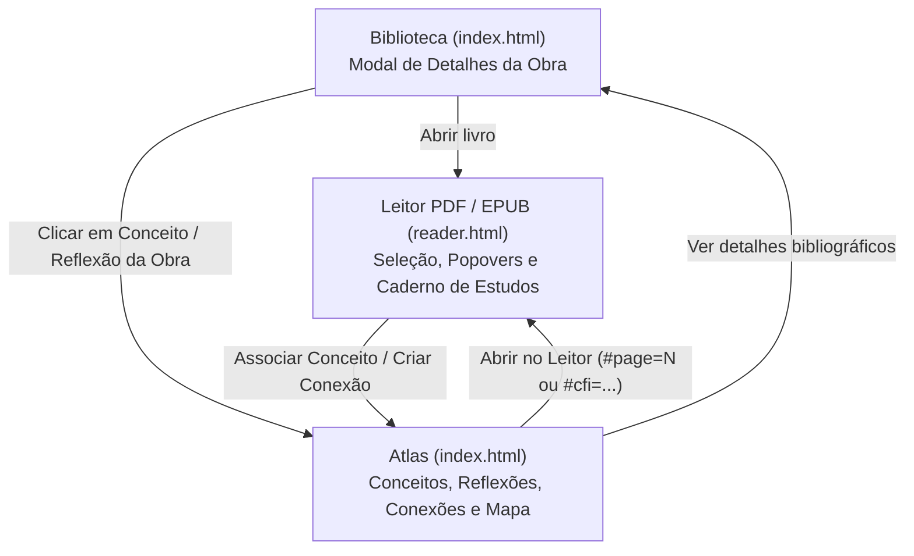

# Experiência do Usuário, Jornadas Reais e Wireframes Documentais — Lectoria v1.9.0

- **Versão Planejada**: `v1.9.0 — Conhecimento Conectado`
- **Natureza do Documento**: Proposta de integração de interface nos quatro contextos da aplicação, análise de nomenclatura, wireframes exclusivamente documentais e sete jornadas completas de utilização.

---

## 1. Integração aos Quatro Contextos da Interface Atual

A diretriz central de UX para a v1.9.0 é **progressividade silenciosa**: o leitor que deseja apenas abrir um romance e ler sem distrações continuará encontrando exatamente a mesma interface limpa da v1.8.0. As ferramentas de Conhecimento Conectado emergem nos momentos de seleção, anotação, estudo no caderno e exploração dedicada.

---

### Contexto A — Durante a Leitura (`static/reader.html`)

#### Princípio de Design
**Não adicionar novos botões permanentes ao cabeçalho `.reader-header`** (que já foi compactado na v1.8.0 para evitar overflow horizontal em `1366x768` e tablets). Toda interação de conhecimento durante a leitura ocorre nos componentes contextuais já existentes:

1. **Na Barra Flutuante de Seleção (`#selection-toolbar`)**:
   - Mantém as 5 cores de destaque, o botão `Nota` e (quando aplicável) `Compartilhar na Leitura Coletiva`.
   - Adiciona apenas um botão compacto `Conceito` (ou ícone de vínculo/tag conceitual) ao lado de `Nota`, permitindo vincular rapidamente um trecho recém-selecionado a um conceito existente ou criar um conceito novo em 2 cliques.
2. **Nos Popovers de Destaque (`#highlight-popover`) e de Nota (`#page-note-popover`)**:
   - Exibe os **chips de conceitos associados** ao destaque/nota (clicáveis para abrir o resumo do conceito).
   - Exibe um indicador compacto de **conexões e backlinks** (ex.: `2 conexões · 1 reflexão`), que ao ser clicado expande a lista de elementos relacionados sem sair da página.
   - Nas ações do popover (`#hl-pop-actions` / `#note-pop-actions`), inclui os botões discretos `+ Conceito` e `+ Conectar`.
3. **No Modal de Criação/Edição de Nota (`#modal-note-editor`)**:
   - Abaixo do campo de texto da nota, adiciona um campo opcional leve de **Conceitos associados** (input com autocompletar instantâneo dos conceitos do usuário e opção *"Criar novo conceito: ..."*).

#### Wireframe Documental — Popover Contextual de Destaque no Leitor (`reader.html`)

```text
+-----------------------------------------------------------------------+
| [●] Você                                           [Privado]   [x]    |
+-----------------------------------------------------------------------+
| "A técnica tornou-se um meio autônomo que não reconhece mais          |
|  limites externos de natureza moral ou política."                     |
+-----------------------------------------------------------------------+
| Nota: Ellul define aqui a autonomia técnica em oposição à visão       |
| instrumental clássica.                                                |
+-----------------------------------------------------------------------+
| Conceitos: [ ◈ Técnica × ] [ ◈ Autonomia dos Meios × ]  [+ Conceito]  |
| Relações:  ⇄ Contradiz nota em "A Questão da Técnica" (p. 18)         |
|            ↖ Citado na reflexão "Ensaio sobre Filosofia da Técnica"   |
+-----------------------------------------------------------------------+
| [Editar Nota]  [+ Conectar]  [Tornar Público]  [Excluir]              |
+-----------------------------------------------------------------------+
```

---

### Contexto B — Caderno de Estudos (`#annotations-drawer` em `reader.html`)

#### Extensões Naturais Preservando a v1.8.0
1. **Preservação Integral da v1.8.0**:
   - Mantém o seletor de escopo (`Minhas`, `Públicas`, `Todas visíveis`), a ordenação (`Posição no livro`, `Mais recentes`), a pesquisa com debounce e as abas `Todas`, `Destaques`, `Notas`, `Desenhos` e `Marcadores`.
2. **Filtro Rápido por Conceito do Livro Atual**:
   - Quando o livro aberto possuir anotações vinculadas a conceitos do usuário, uma faixa horizontal discreta de chips filtráveis aparece abaixo da busca (ex.: `Todos os conceitos`, `◈ Técnica (6)`, `◈ Alienação (3)`), permitindo filtrar o Caderno de Estudos daquela obra por conceito com um clique.
3. **Exibição de Relações e Backlinks nos Cartões do Caderno**:
   - Cada cartão de destaque ou nota no Caderno de Estudos passa a exibir seus chips de conceitos e um rodapé expansível de relações (`⇄ 2 conexões · ↖ 1 backlink`), com links diretos para saltar à outra página/livro ou abrir o modal de conexão.
4. **Acesso Rápido às Reflexões Relacionadas ao Livro**:
   - Um botão ou subaba compacta `Reflexões (N)` permite consultar ou redigir uma reflexão autoral vinculada ao livro que está sendo lido sem perder a página atual.

#### Wireframe Documental — Caderno de Estudos Estendido (`#annotations-drawer`)

```text
+------------------------------------------------------------------+
| Caderno de Estudos                                           [x] |
+------------------------------------------------------------------+
| [ Pesquisar por texto, conceito ou autor...                  ]   |
| [Minhas] [Públicas] [Todas visíveis*]   Ordenar: [Posição v]     |
| Conceitos neste livro: [Todos*] [◈ Técnica (4)] [◈ Poder (2)]    |
| [Todas (12)] [Destaques] [Notas] [Desenhos] [Marcadores] [Reflex]|
+------------------------------------------------------------------+
| PÁGINA 42 · Cap. 2                                               |
| +--------------------------------------------------------------+ |
| | [Nota] [Você] [🔒 Privada]                   18/11/2026 14:20| |
| | > "A técnica tornou-se um meio autônomo..."                  | |
| | Ellul define aqui a autonomia técnica...                     | |
| |                                                              | |
| | [◈ Técnica] [◈ Autonomia dos Meios]                          | |
| | ⇄ Complementa: Heidegger, "A Questão da Técnica" (Pág. 14)   | |
| | ↖ Referenciado em: Reflexão "Notas para o Capítulo 1"        | |
| |                                                              | |
| | [Ir p/ Pág.] [+ Conceito] [+ Conectar] [Editar] [Publicar]   | |
| +--------------------------------------------------------------+ |
+------------------------------------------------------------------+
```

---

### Contexto C — Biblioteca (`static/index.html`)

#### Indicadores Discretos sem Poluir os Cards
1. **Nos Cards da Grade e Lista (`.book-card`)**:
   - Para não sobrecarregar visualmente a estante nem violar a proporção editorial das capas (`1 / 1.42`), os cards da grade **não** exibem listas longas de conceitos.
   - Opcionalmente, exibe-se apenas um micro-indicador sutil no rodapé de metadados quando o usuário possui conhecimento estruturado naquela obra (ex.: ícone discreto `◈ 3` indicando 3 conceitos estudados na obra, visível apenas para o próprio usuário).
2. **No Modal de Detalhes da Obra (`#modal-book-details`)**:
   - Adiciona uma subaba ou seção **"Conhecimento Conectado"** ao lado de *Visão Geral*, *Reconciliação Externa* e *Edição Manual*, apresentando:
     - **Conceitos estudados nesta obra** (chips clicáveis que levam ao conceito).
     - **Obras conectadas** (outros livros do acervo cujas anotações possuem relações diretas com anotações deste livro).
     - **Reflexões autorais associadas** a este livro.

---

### Contexto D — Novo Espaço Principal: **Atlas** (`static/index.html`)

#### Nomenclatura Oficial Aprovada em Português (`KD-010: APPROVED`)

Avaliamos as opções de nome para a nova seção principal na barra `.main-view-tabs`:

| Nome Proposto | Conotação de Produto | Pontos Fortes | Pontos Fracos |
| :--- | :--- | :--- | :--- |
| **1. Conhecimento** | Direta, clara e funcional. | Autoexplicativo; alinha-se ao título da versão (*Conhecimento Conectado*). | Ligeiramente abstrato/genérico. |
| **2. Caderno Intelectual** | Editorial, humanista e acadêmica. | Forte harmonia com a estética clássica da Lectoria e com o *Caderno de Estudos* do leitor. | Um pouco longo para telas de `320px`, e pode confundir com o `#annotations-drawer` local do livro. |
| **3. Rede de Ideias** | Relacional e associativa. | Comunica imediatamente conexões entre notas, livros e conceitos. | Pode soar focado apenas no grafo visual e menos nas reflexões escritas. |
| **4. Atlas (APROVADO)** | Cartográfica e exploratória. | Curto (5 letras, ótimo em mobile), evocativo, editorial e elegante. | Acompanhado de subtítulo claro ("Conceitos, Reflexões, Conexões e Mapa de Ideias") para orientar na primeira visita. |
| **5. Ideias e Conceitos** | Descritiva e explícita. | Deixa claro o que o usuário encontrará ali. | Composto (mais largo na barra de abas). |
| **6. Mapa de Conhecimento** | Visual e estrutural. | Descreve bem a visão gráfica. | Reduz a seção apenas ao mapa/grafo, omitindo reflexões e fichamentos. |
| **7. Caderno de Ideias** | Equilíbrio entre o editorial e o conceitual. | Mais curto que *Caderno Intelectual*, acolhedor tanto para estudo técnico quanto literário/filosófico. | — |

- **Decisão Oficial Consolidada (`KD-010: APPROVED` — Alternativa 5)**: O nome oficial da nova seção principal será **`Atlas`** no rótulo da aba principal (`#tab-nav-knowledge` / `data-nav="knowledge"`), com subtítulo interno *"Conceitos, Reflexões, Conexões e Mapa de Ideias"*. Nos módulos Python (`knowledge_service.py`), tabelas SQLite (`knowledge_links`, `knowledge_fts`) e rotas REST (`/api/knowledge/*`), mantém-se o identificador técnico `knowledge`.

#### Wireframe Documental — Espaço Principal Atlas (`index.html`)

```text
+-----------------------------------------------------------------------------------+
| Lectoria      [Descoberta] [Biblioteca] [Atlas*] [Nossa Biblioteca] [Clubes]      |
+-----------------------------------------------------------------------------------+
| Atlas — Conhecimento Conectado                          [+ Novo Conceito]         |
| Organize conceitos, conexões entre obras e reflexões.   [+ Nova Reflexão]         |
|                                                         [Exportar Conhecimento v] |
+-----------------------------------------------------------------------------------+
| [ 🔍 Pesquisar em conceitos, notas, destaques, reflexões e livros...            ] |
+-----------------------------------------------------------------------------------+
| Subabas: [ ◈ Conceitos (18) ] [ ✎ Reflexões (7) ] [ ⇄ Conexões (42) ] [ ◎ Mapa ]  |
+-----------------------------------------------------------------------------------+
|                                                                                   |
|  COLUNA ESQUERDA: Lista de Conceitos     |  PAINEL CENTRAL: Detalhe do Conceito   |
|  -----------------------------------     |  -----------------------------------   |
|  Filtrar tag: [Todas v] Ordem: [Recentes]|  ◈ TÉCNICA                             |
|                                          |  Tags: #filosofia #modernidade         |
|  > ◈ Técnica                        [8]  |  Atualizado em 18/11/2026              |
|    3 livros · 6 notas · 2 reflexões      |                                        |
|                                          |  DEFINIÇÃO AUTORAL                     |
|    ◈ Poder Disciplinar              [5]  |  Conjunto de procedimentos racionais   |
|    2 livros · 4 notas · 1 reflexão       |  voltados à eficácia máxima que, na    |
|                                          |  modernidade, passa de meio a sistema  |
|    ◈ Alienação                      [4]  |  autônomo.                             |
|    3 livros · 4 notas                    |                                        |
|                                          |  CONCEITOS RELACIONADOS                |
|    ◈ Continuidade Uniforme          [3]  |  -> Desenvolve: [◈ Racionalização]     |
|    2 livros · 3 notas                    |  -> Tensiona:   [◈ Autonomia Moral]    |
|                                          |                                        |
|                                          |  PASSAGENS E NOTAS POR OBRA (3 livros) |
|                                          |  1. Jacques Ellul — A Técnica e o...   |
|                                          |     • Pág. 42 (Destaque + Nota) [Abrir]|
|                                          |     • Pág. 89 (Destaque)        [Abrir]|
|                                          |  2. Martin Heidegger — A Questão da... |
|                                          |     • CFI Cap. 1 (Nota)         [Abrir]|
|                                          |                                        |
|                                          |  REFLEXÕES E BACKLINKS (2)             |
|                                          |  • Reflexão: "Ellul vs. Heidegger"     |
|                                          |                                        |
|                                          |  [Ver no Mapa Local] [Editar] [Excluir]|
+-----------------------------------------------------------------------------------+
```

#### Wireframe Documental — Subaba Mapa de Conhecimento e Alternativa Textual

```text
+-----------------------------------------------------------------------------------+
| Modo de Visualização: [ (•) Mapa Visual (SVG) ]  [ ( ) Visão Textual Acessível ]  |
| Foco: [ ◈ Conceito: Técnica v ]  Profundidade: [ 1 salto | 2 saltos* ]  Filtro:   |
|       [x] Livros  [x] Conceitos  [x] Notas/Destaques  [x] Reflexões               |
+-----------------------------------------------------------------------------------+
|                                                                                   |
|         [Livro: A Questão da Técnica]          [Livro: A Técnica e o Desafio]     |
|                      \                                      /                     |
|                 (pertence a)                           (pertence a)               |
|                        \                                  /                       |
|        [Nota Cap. 1: Gestell] <--- (contradiz) ---> [Destaque Pág. 42: Autonomia] |
|                        \                                  /                       |
|                         \---> ( ( ◈ TÉCNICA ) ) <--------/                        |
|                                  /           \                                    |
|                        (fundamenta)         (relaciona-se)                        |
|                                /               \                                  |
|     [Reflexão: Ensaio sobre a Técnica]     [◈ Conceito: Racionalização]           |
|                                                                                   |
|  Legenda: (◈) Conceito   [■] Livro   [○] Nota/Destaque   [◇] Reflexão             |
|  Clique em um nó para inspecionar lateralmente; duplo clique para expandir/abrir. |
+-----------------------------------------------------------------------------------+
```

---

## 2. Diagrama de Fluxo de Navegação entre Contextos



---

## 3. Cenários Reais de Utilização (Jornadas Completas)

### Cenário 1 — Leitura Filosófica Transversal (Construção de Conceito entre Obras)
1. **Contexto inicial**: A usuária Helena está lendo *A Técnica e o Desafio do Século* (Jacques Ellul, PDF) na página 42.
2. **Ação no leitor**: Ela seleciona um parágrafo sobre a autonomia da técnica, aplica um destaque amarelo e clica nele para abrir o `#highlight-popover`.
3. **Criação do conceito**: No popover, clica em `+ Conceito`, digita `Técnica` e adiciona uma breve definição inicial. O conceito `Técnica` é criado como privado (`user_id` de Helena) e vinculado ao destaque da página 42.
4. **Expansão em segunda obra**: Dias depois, Helena abre *A Questão da Técnica* (Martin Heidegger, EPUB). Ao destacar o trecho sobre *Gestell* (composição/armação), ela abre o popover e vincula o destaque ao conceito existente `Técnica`.
5. **Conexão explícita entre trechos**: Ainda no popover do destaque de Heidegger, Helena clica em `+ Conectar`, pesquisa por `"autonomia"` ou filtra pelo conceito `Técnica`, seleciona a nota de Ellul (página 42), escolhe a relação **`Complementa`** (`complements`) e escreve a justificativa: *"Enquanto Ellul descreve a autonomia sociológica do fenômeno técnico, Heidegger investiga sua essência ontológica como desvelamento desafiador."*
6. **Resultado**: Ao abrir o conceito `Técnica` no Espaço de Conhecimento, Helena vê reunidas as duas obras, os trechos de Ellul e Heidegger (com botão *Abrir no leitor* para `#page=42` no PDF e `#cfi=...` no EPUB) e a conexão semântica justificada entre ambos.

---

### Cenário 2 — Preparação para Estudos Exatos (Definições, Propriedades, Exemplos e Dúvidas)
1. **Contexto inicial**: O estudante Lucas estuda Cálculo e Análise Real usando dois PDFs: *Um Curso de Cálculo Vol. 1* (Guidorizzi) e *Curso de Análise Vol. 1* (Elon Lages Lima).
2. **Organização conceitual**:
   - Ao ler a definição formal de limite em Guidorizzi (página 78), Lucas cria o conceito `Continuidade Uniforme` com a etiqueta `#analise-matematica`.
   - Ao encontrar um contraexemplo clássico em Elon Lages Lima (página 145, função $f(x) = 1/x$ em $(0, 1)$), ele cria uma nota com um desenho vetorial do gráfico na página e a conecta ao destaque da definição usando o tipo **`Exemplifica`** (`exemplifies`).
   - Em uma passagem cuja passagem algébrica não ficou clara (Elon, página 147), ele cria uma nota privada e a conecta ao conceito usando o tipo **`Questiona`** (`questions`), escrevendo sua dúvida de estudo.
3. **Revisão pré-prova**: Na véspera da prova, Lucas abre o conceito `Continuidade Uniforme` e filtra suas conexões por tipo: revisa primeiro as notas que *Fundamentam* a definição, depois as que *Exemplificam* e por fim resolve as marcadas como *Questiona*.

---

### Cenário 3 — Produção de Ensaio (Síntese Autoral com Rastreabilidade às Fontes)
1. **Contexto inicial**: Helena deseja escrever um ensaio comparativo sobre modernidade e vigilância a partir de três livros já lidos e anotados na Lectoria.
2. **Criação da reflexão**: Na seção **Conhecimento > Reflexões**, ela clica em `+ Nova Reflexão`, define o título *"Da Disciplina ao Espetáculo: Notas para um Ensaio"* e associa os conceitos `Poder Disciplinar` e `Sociedade do Espetáculo`.
3. **Inserção de referências rastreáveis**:
   - Enquanto escreve o texto em Markdown, ela aciona o botão `Inserir Referência` (ou atalho), busca seus destaques sobre panoptismo e seleciona dois trechos de livros diferentes.
   - O sistema registra os vínculos estruturados (`reflection_references` / `knowledge_links`) entre a reflexão e os destaques originais.
4. **Rastreabilidade bidirecional**:
   - Ao visualizar a reflexão renderizada, cada citação possui um link discreto `[Vigiar e Punir, p. 177 — Abrir no leitor]` que abre exatamente a página original.
   - Inversamente, quando Helena estiver relendo a página 177 de *Vigiar e Punir* meses depois, o popover daquele destaque mostrará o backlink: `↖ Utilizado na reflexão: "Da Disciplina ao Espetáculo"`.

---

### Cenário 4 — Revisão de Longo Prazo (Retorno Meses Depois e Descoberta por Backlinks)
1. **Contexto inicial**: Seis meses após concluir a leitura de cinco livros de história econômica, o usuário Marcos quer retomar o estudo sobre *Inflação Inercial*.
2. **Pesquisa integrada**: Ele digita `"inercial"` na barra de pesquisa integrada da seção **Conhecimento**.
3. **Recuperação imediata**: O motor FTS5 retorna em milissegundos:
   - O conceito `Inflação Inercial`.
   - Três destaques em dois livros distintos onde o termo aparece.
   - Uma reflexão escrita por ele há seis meses.
4. **Exploração no Mapa Local**: Marcos abre a subaba **Mapa** centrada em `Inflação Inercial` (ou sua alternativa textual) e percebe que esse conceito está ligado ao conceito `Indexação Salarial`, que por sua vez possui notas em um terceiro livro que ele já havia esquecido. Com um clique, ele reabre o terceiro livro na página exata da nota.

---

### Cenário 5 — Leitura Colaborativa com Redes de Conhecimento Privadas Isoladas
1. **Contexto inicial**: Alice e Bob têm acesso ao mesmo livro *Dom Casmurro* na instância Lectoria.
2. **Anotação pública**: Alice destaca um trecho no capítulo 32 e opta por torná-lo **Público** (`visibility = 'public'`).
3. **Rede privada de Bob sobre anotação pública de Alice**:
   - Bob está lendo o capítulo 32 com o modo de camada `Minhas + Públicas` ativo, vê o destaque público de Alice e acha a passagem excelente para seu estudo privado sobre `Narrador Não Confiável`.
   - Bob vincula o destaque público de Alice ao seu conceito privado `Narrador Não Confiável` e cria uma conexão privada entre a sua própria nota privada (no capítulo 12) e o destaque público de Alice (`Complementa`).
4. **Garantia de isolamento**:
   - O conceito `Narrador Não Confiável` de Bob, a nota privada de Bob e a conexão criada por Bob pertencem exclusivamente a Bob (`user_id = Bob`).
   - Quando Alice visualiza o próprio destaque público no capítulo 32, ela **jamais** vê nos seus backlinks os conceitos privados, notas privadas ou reflexões privadas de Bob. Nenhuma informação ou contagem da rede privada de Bob vaza para Alice.

---

### Cenário 6 — Exclusão ou Revogação de Visibilidade (Integridade sem Vazamento)
1. **Contexto inicial**: Continuando o Cenário 5, Bob possui em sua rede privada uma conexão apontando para o destaque público `H_alice` de Alice.
2. **Evento A — Alice revoga a publicação (`public → private`)**:
   - Alice altera a visibilidade de `H_alice` de `public` para `private` via `PATCH /api/books/{id}/highlights/{hid}/visibility`.
   - **Comportamento obrigatório do sistema**:
     - Quando Bob consulta seu conceito `Narrador Não Confiável`, sua lista de conexões, seus backlinks, sua pesquisa FTS5 ou sua exportação, o sistema verifica em tempo de leitura a autorização sobre o elemento alvo (`target`).
     - Como `H_alice` agora é `private` de outro usuário, **nenhum texto, página, capítulo ou nome de autor de `H_alice` é retornado para Bob**.
     - A conexão privada de Bob não quebra o banco de dados, mas é apresentada a Bob apenas como `[Referência externa indisponível ou revogada pelo autor]` (com opção para Bob remover o vínculo órfão), preservando intacta a justificativa autoral que o próprio Bob havia escrito.
3. **Evento B — Alice exclui fisicamente `H_alice` (ou o livro tem sua fonte desativada)**:
   - Se `H_alice` for excluído, o vínculo aponta para um item removido; Bob mantém sua nota/reflexão autoral intacta sem erro `500`, visualizando a indicação neutra de referência removida, sem qualquer vazamento de dados não autorizados.

---

### Cenário 7 — Exportação e Portabilidade Integral do Conhecimento Pessoal
1. **Contexto inicial**: Helena deseja fazer backup externo de toda a sua produção intelectual do semestre e abri-la também em um leitor de arquivos Markdown local.
2. **Ação**: Na seção **Conhecimento**, ela clica em `Exportar Conhecimento` e escolhe `Pacote Markdown Interligado (.zip)`.
3. **Resultado**: Ela recebe um arquivo `.zip` contendo:
   - Uma pasta `conceitos/` com um arquivo `.md` para cada conceito e suas definições, conexões e citações.
   - Uma pasta `reflexoes/` com seus textos autorais e links relativos para os conceitos e cadernos de livros.
   - Uma pasta `livros/` com os cadernos de estudos de cada obra anotada por ela (`scope='mine'`), preservando os identificadores estáveis, páginas PDF e `epub_cfi` no cabeçalho YAML.
   - Nenhum dado privado de outro usuário da instância é incluído no pacote.
