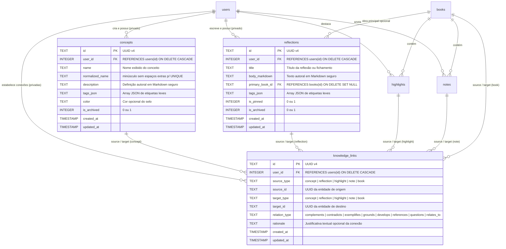

# Modelo de Domínio e Arquitetura de Dados — Lectoria v1.9.0

- **Versão Planejada**: `v1.9.0 — Conhecimento Conectado` (Seção principal: **Atlas**)
- **Natureza do Documento**: Modelagem conceitual do domínio, comparação técnica das quatro alternativas relacionais em SQLite, diagramas Entidade-Relacionamento, exemplos de dados e especificação da migração `v12 → v13` (`KD-011: APPROVED`).
- **Status Consolidado (Fase 1)**: Modelo Híbrido Aditivo aprovado (`KD-002`, `KD-003`, `KD-004`, `KD-005`, `KD-008`, `KD-011` `APPROVED`) e implementado em `database.py` (`_apply_migration_v13`).

---

## 1. Entidades do Domínio de Conhecimento Conectado

O domínio introduzido pela v1.9.0 articula elementos já existentes na v1.8.0 (**Livros**, **Destaques**, **Notas**) com novas entidades intelectuais do usuário:

1. **Conceito (`concepts`)**:
   - Ideia, termo teórico, definição ou tema estudado transversalmente pelo usuário ao longo de diferentes livros (ex.: *Técnica*, *Poder Disciplinar*, *Continuidade Uniforme*).
   - Possui identidade estável (`id` UUID v4), nome (`name`), definição/descrição autoral (`description`), etiquetas leves (`tags_json`) e pertence estritamente ao usuário que o criou (`user_id`).
2. **Reflexão Autoral (`reflections`)**:
   - Texto autoral estruturado em Markdown seguro que não está preso a uma única página de um único livro (ex.: fichamento comparativo, síntese de leitura, rascunho de ensaio, hipótese de estudo).
   - Possui identidade estável (`id` UUID v4), título (`title`), corpo (`body_markdown`), etiquetas (`tags_json`), livro principal opcional (`primary_book_id NULL`) e pertence ao usuário (`user_id`).
3. **Vínculo / Conexão de Conhecimento (`knowledge_links`)**:
   - Relação explícita, direcionada e opcionalmente justificada (`rationale`) criada por um usuário (`user_id`) entre dois elementos do ecossistema:
     - `highlight` (Destaque em PDF ou EPUB)
     - `note` (Nota em PDF ou EPUB)
     - `concept` (Conceito do usuário)
     - `reflection` (Reflexão autoral do usuário)
     - `book` (Obra do acervo)
   - Tipos semânticos de relação (`relation_type`):
     - `complements` (*Complementa*)
     - `contradicts` (*Contradiz*)
     - `exemplifies` (*Exemplifica*)
     - `grounds` (*Fundamenta*)
     - `develops` (*Desenvolve*)
     - `references` (*Referencia*)
     - `questions` (*Questiona*)
     - `relates_to` (*Relaciona-se com* — padrão neutro)

---

## 2. Comparação das Quatro Abordagens de Modelagem Relacional em SQLite

Avaliamos quatro arquiteturas relacionais para representar as entidades e suas relações no SQLite:

### Abordagem 1 — Tabelas Especializadas por Par de Entidades
Cria uma tabela associativa separada para cada combinação possível: `concept_highlights`, `concept_notes`, `concept_books`, `concept_concepts`, `annotation_links` (highlight↔highlight, note↔note, highlight↔note), `reflection_concepts`, `reflection_highlights`, `reflection_notes`, `reflection_books`.
- **Pontos fortes**: Chaves estrangeiras declarativas nativas (`FOREIGN KEY ... REFERENCES ... ON DELETE CASCADE`) em cada coluna.
- **Pontos fracos**:
  - Explosão combinatória: relacionar 5 tipos de entidades (`book`, `highlight`, `note`, `concept`, `reflection`) exige **10 a 15 tabelas de junção distintas**.
  - Consultar todos os backlinks de uma nota ou montar o grafo local de 2 saltos exigiria `UNION ALL` de 10 tabelas diferentes em cada query, tornando a manutenção e a paginação complexas e propensas a erros.

### Abordagem 2 — Tabela Genérica de Conexões Polimórficas Pura
Mantém tabelas próprias para `concepts` e `reflections`, mas unifica **todas** as associações e relações semânticas em uma única tabela `knowledge_links(id, user_id, source_type, source_id, target_type, target_id, relation_type, rationale)`.
- **Pontos fortes**:
  - Consulta de backlinks, conexões de saída e vizinhança de grafo em **1 única tabela** com índices compostos `(user_id, source_type, source_id)` e `(user_id, target_type, target_id)`.
  - Suporta `WITH RECURSIVE` limpo para vizinhança de 1 ou 2 saltos.
- **Pontos fracos se usada sem cuidados**:
  - O SQLite não permite `FOREIGN KEY (source_id)` condicional por `source_type` declarativamente; sem *triggers* SQLite, poderiam restar arestas órfãs ao excluir um conceito ou nota.

### Abordagem 3 — Modelo Unificado de Entidades (`knowledge_nodes` + `knowledge_edges`)
Substitui ou espelha livros, destaques, notas, conceitos e reflexões dentro de uma supertabela única `knowledge_nodes(id, node_type, ...)` e `knowledge_edges(source_id, target_id, ...)`.
- **Pontos fortes**: Chaves estrangeiras simples entre `knowledge_edges` e `knowledge_nodes`.
- **Pontos fracos (Inadequado para a Lectoria)**:
  - `books`, `highlights` e `notes` já existem em produção no Schema v12 e são intensamente consultados por `library.py`, `annotations_service.py` e `reader.js`.
  - Migrar `highlights` e `notes` para uma supertabela quebraria toda a base existente; espelhá-los via triggers duplicaria armazenamento e I/O de disco a cada destaque criado no leitor.

### Abordagem 4 — Abordagem Híbrida (Entidades Fortemente Tipadas + Tabela Unificada de Arestas com Triggers de Integridade) — **RECOMENDADA**
1. **Preserva 100% intactas as tabelas existentes** (`books`, `highlights`, `notes`, `page_drawings`, `bookmarks`).
2. **Cria duas tabelas de entidade fortemente tipadas** para os novos objetos autorais:
   - `concepts` (com `user_id REFERENCES users(id) ON DELETE CASCADE`).
   - `reflections` (com `user_id REFERENCES users(id) ON DELETE CASCADE` e `primary_book_id REFERENCES books(id) ON DELETE SET NULL`).
3. **Unifica todas as relações e backlinks em uma tabela canônica `knowledge_links`**, complementada por **triggers SQLite de integridade referencial** na inserção e na exclusão de `concepts`, `reflections`, `highlights` e `notes`.

---

### 2.1. Matriz de Avaliação das Abordagens Relacionais

| Critério | 1. Tabelas Especializadas | 2. Polimórfica Pura (sem triggers) | 3. Nós Unificados (`knowledge_nodes`) | 4. Híbrida com Triggers (Recomendada) |
| :--- | :---: | :---: | :---: | :---: |
| **Integridade referencial e FKs** | Alta (declarativa) | Baixa (risco de órfãos) | Alta (mas duplica dados) | **Alta** (FK em `user_id` + triggers SQLite automáticos) |
| **Complexidade das consultas (Backlinks / Grafo)** | Muito Alta (`10x UNION ALL`) | Baixa (`1 SELECT`) | Baixa | **Muito Baixa** (`1 SELECT` indexado) |
| **Exclusão em cascata / limpeza** | Automática via FK | Manual na aplicação | Automática via FK | **Automática via Triggers SQLite** + tratamento seguro de revogação |
| **Isolamento por usuário (`user_id`)** | Espalhado em 12 tabelas | Centralizado | Centralizado | **Centralizado e garantido por índice e constraint** |
| **Tratamento de ciclos no grafo** | Difícil de percorrer | Simples com `WITH RECURSIVE` | Simples com `WITH RECURSIVE` | **Simples** (bloqueio de auto-loop `source != target` + controle de visitados) |
| **Prevenção de duplicações** | `UNIQUE` em cada tabela | `UNIQUE` único | `UNIQUE` único | **`UNIQUE(user_id, source_type, source_id, target_type, target_id, relation_type)`** |
| **Eficiência de índices e RAM** | 25+ índices separados | 4 índices | Dados duplicados | **6 índices enxutos e compostos** |
| **Compatibilidade com v1.8.0** | Alta | Alta | **Baixa (invasiva)** | **Total (100% aditiva)** |

---

## 3. Especificação Conceitual do Modelo Híbrido Recomendado

### 3.1. Diagrama Entidade-Relacionamento (ERD)



---

### 3.2. Regras de Integridade, Ciclos, Exclusão e Revogação

1. **Prevenção de Auto-Referência (`Self-Loop`) e Duplicatas**:
   - Constraint `CHECK (NOT (source_type = target_type AND source_id = target_id))`: um item nunca pode ser conectado a si mesmo.
   - Índice único `uq_knowledge_links_tuple ON knowledge_links(user_id, source_type, source_id, target_type, target_id, relation_type)`: impede criação duplicada da mesma relação pelo mesmo usuário.
2. **Permissão de Ciclos entre Nós Distintos com Travessia Segura**:
   - No conhecimento humano, ciclos entre nós distintos são naturais ($A \to B \to C \to A$). O banco permite ciclos entre entidades distintas, e as consultas de grafo limitam a profundidade a `depth <= 2` rastreando o conjunto de nós já visitados em Python/SQL para nunca entrar em loop infinito.
3. **Política de Exclusão e Integridade Referencial**:
   - Quando o próprio usuário exclui um `concept` ou `reflection` seu, um trigger SQLite (`AFTER DELETE ON concepts` / `AFTER DELETE ON reflections`) remove automaticamente as linhas de `knowledge_links` daquele usuário onde aquele item era `source` ou `target`, e atualiza o índice `knowledge_fts`.
   - Quando um `highlight` ou `note` é excluído:
     - Se o vínculo em `knowledge_links` não possuir justificativa textual (`rationale = ''` e pertencer ao mesmo autor), pode ser limpo automaticamente;
     - Se o vínculo pertencer a outro usuário (que havia conectado uma nota sua a uma anotação pública de terceiro posteriormente excluída ou tornada privada), a resolução em tempo de consulta (`resolve_link_endpoints`) detecta que o alvo não está mais disponível/autorizado e retorna um marcador seguro `target_status = "unavailable"`, **sem vazar dados privados e sem destruir a justificativa autoral do usuário**.

---

### 3.3. Exemplos Conceituais de Registros

#### Exemplo 1: Conceito Criado pelo Usuário (`concepts`)
```json
{
  "id": "c4f19e82-7b1a-4d3c-9e5b-1029384756ab",
  "user_id": 2,
  "name": "Técnica",
  "normalized_name": "técnica",
  "description": "Sistema de meios racionais voltados à eficiência máxima que, na modernidade, adquire autonomia própria frente aos fins humanos.",
  "tags_json": "[\"filosofia\", \"modernidade\"]",
  "color": "#d4a853",
  "is_archived": 0,
  "created_at": "2026-11-18T14:20:00Z",
  "updated_at": "2026-11-18T15:10:00Z"
}
```

#### Exemplo 2: Conexão entre Nota de um Livro e Destaque de Outro Livro (`knowledge_links`)
```json
{
  "id": "e8a12b34-9c0d-4f11-8a22-334455667788",
  "user_id": 2,
  "source_type": "note",
  "source_id": "91a0b2c3-d4e5-4f60-8711-223344556677",
  "target_type": "highlight",
  "target_id": "12f3e4d5-c6b7-4a89-9012-3456789abcde",
  "relation_type": "complements",
  "rationale": "A análise de Heidegger sobre a essência da técnica como Gestell aprofunda ontologicamente a descrição sociológica da autonomia técnica em Ellul.",
  "created_at": "2026-11-18T15:12:00Z",
  "updated_at": "2026-11-18T15:12:00Z"
}
```

#### Exemplo 3: Associação de um Destaque a um Conceito (`knowledge_links`)
```json
{
  "id": "77b66a55-44c3-4d22-9e11-009988776655",
  "user_id": 2,
  "source_type": "highlight",
  "source_id": "12f3e4d5-c6b7-4a89-9012-3456789abcde",
  "target_type": "concept",
  "target_id": "c4f19e82-7b1a-4d3c-9e5b-1029384756ab",
  "relation_type": "relates_to",
  "rationale": "",
  "created_at": "2026-11-18T14:21:00Z",
  "updated_at": "2026-11-18T14:21:00Z"
}
```

---

## 4. Avaliação sobre Migração de Schema (`v12 → v13`)

### É obrigatório migrar o schema de `v12` para `v13`?
- **Análise técnica**:
  - As tabelas atuais do Schema `v12` (`highlights`, `notes`, `page_drawings`, `bookmarks`, `collections`, `categories`, `subjects`) não possuem colunas nem tabelas capazes de armazenar **Conceitos independentes de livros**, **Reflexões multi-livro** ou **Arestas de conexão entre duas anotações com justificativa**.
  - Tentar embutir conexões e conceitos dentro do texto livre de `notes.content` ou reaproveitar `collections` violaria a integridade relacional, impediria consultas indexadas de backlinks e exigiria parsing lento de strings em toda leitura.
- **Conclusão e Decisão Aprovada (`KD-011: APPROVED`)**:
  - A implementação da v1.9.0 utiliza a migração incremental `v12 → v13` (`_apply_migration_v13`), **100% aditiva**:
    - Não altera nem reconstrói nenhuma tabela existente da v1.8.0 (`books`, `highlights`, `notes`, `page_drawings`, `bookmarks` permanecem intactas).
    - Cria `concepts`, `reflections`, `knowledge_links`, a tabela virtual `knowledge_fts` (FTS5 com `tokenize='unicode61 remove_diacritics 2'`) e seus respectivos índices e triggers dentro da transação atômica padrão do `database.init_db()`, precedida pelo backup automático `lectoria_pre_migration_v12_to_v13_<timestamp>.db`.
  - **Invariante de Imutabilidade de Migração Publicada (Seção 13.7)**: Todas as estruturas persistentes da v1.9.0 (incluindo `knowledge_fts`) nascem consolidadas dentro de `_apply_migration_v13`. Uma vez publicada uma versão de schema, sua função de migração nunca é editada retroativamente; alterações posteriores exigiriam nova versão incremental.
