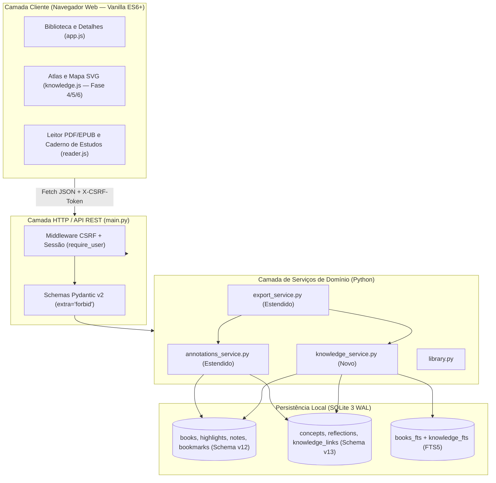

# Arquitetura Técnica Proposta — Lectoria v1.9.0

- **Versão Planejada**: `v1.9.0 — Conhecimento Conectado` (Seção principal oficial: **Atlas**)
- **Natureza do Documento**: Desenho da arquitetura técnica de backend, contratos de API REST, módulos frontend Vanilla JS, motor de pesquisa FTS5 e motor leve de visualização de grafo e alternativa textual.
- **Status Consolidado (Fase 1)**: Decisões `KD-001` a `KD-011` aprovadas pelo proprietário. Fundação do domínio (`knowledge_service.py` e Schema SQLite v13) implementada na Fase 1; endpoints REST `/api/knowledge/*` reservados para a Fase 2.

---

## 1. Visão Geral da Arquitetura em Camadas (v1.9.0)

A arquitetura proposta preserva rigorosamente a stack tecnológica da Lectoria (**Python 3.10+ / FastAPI / SQLite 3 WAL / Vanilla HTML5, CSS3 e ES6+**, zero frameworks frontend e zero SGBDs externos):



---

## 2. Organização dos Módulos no Backend

### 2.1. Novo Módulo `knowledge_service.py`
Para cumprir a regra de governança do `AGENTS.md` (*"Mantenha serviços desacoplados em arquivos `*_service.py`; não sobrecarregue `main.py` com regras de negócio"*), toda a lógica de Conhecimento Conectado residirá em `knowledge_service.py`:

1. **Gestão de Conceitos (`concepts`)**:
   - `create_concept(user_id, name, description, tags, color)`
   - `list_concepts(user_id, search, tag, book_id, sort_by, include_archived, limit, offset)`: retorna conceitos com contadores agregados de livros, anotações e reflexões associadas em uma única consulta indexada.
   - `get_concept_detail(user_id, concept_id)`: retorna o conceito, suas passagens agrupadas por livro (filtrando acessibilidade em tempo real), conceitos relacionados, reflexões e backlinks.
   - `update_concept(user_id, concept_id, ...)` e `delete_concept(user_id, concept_id)`.
2. **Gestão de Conexões e Backlinks (`knowledge_links`)**:
   - `create_knowledge_link(user_id, source_type, source_id, target_type, target_id, relation_type, rationale)`:
     - Valida que `source` e `target` existem e que o `user_id` tem permissão de leitura sobre ambos (ex.: anotação própria ou anotação pública em livro acessível).
     - Impede auto-loop (`source == target`) e duplicatas.
   - `list_entity_links_and_backlinks(user_id, entity_type, entity_id)`:
     - Retorna `outgoing_links` (onde a entidade é `source`) e `incoming_backlinks` (onde a entidade é `target` e `knowledge_links.user_id == user_id`), enriquecidos com metadados seguros do outro extremo e marcando como `unavailable` qualquer anotação pública de terceiro que tenha sido revogada ou cujo livro esteja inacessível.
   - `delete_knowledge_link(user_id, link_id)`.
3. **Gestão de Reflexões Autorais (`reflections`)**:
   - `create_reflection(user_id, title, content, primary_book_id, tags, linked_items)`
   - `list_reflections(user_id, search, tag, book_id, concept_id, sort_by, limit, offset)`
   - `get_reflection_detail(user_id, reflection_id)`: retorna a reflexão, os conceitos associados, os trechos/livros citados (com localizadores `#page=N` e `#cfi=...`) e os backlinks.
   - `update_reflection(user_id, reflection_id, ...)` e `delete_reflection(user_id, reflection_id)`.
4. **Construção do Subgrafo Local e Visão Textual (`get_knowledge_graph`)**:
   - `get_knowledge_graph(user_id, focus_type, focus_id, depth=1|2, max_nodes=80, entity_filters=...)`:
     - Constrói o grafo de vizinhança centrado no item selecionado (ou visão resumida dos principais conceitos do usuário quando nenhum foco é especificado), retornando `nodes`, `edges`, `truncated` (booleano indicando se houve corte pelo limite `max_nodes`) e `structured_summary` (estrutura pronta para a alternativa textual acessível).
5. **Pesquisa Integrada (`search_knowledge`)**:
   - Consulta federada combinando `books_fts` e `knowledge_fts` (com fallback seguro para `LIKE COLLATE NOCASE` caso FTS5 não esteja disponível em algum ambiente customizado), sempre filtrada por `user_id` e acesso ao livro.

### 2.2. Extensões Leves em `annotations_service.py`
- Ao retornar destaques e notas em `get_highlights()`, `get_notes()` e `get_book_annotations_summary()`, anexar em lote (via `WHERE source_id IN (...) OR target_id IN (...)` para o `user_id` autenticado, **zero N+1**) os chips resumidos de conceitos (`concepts: [{id, name, color}]`) e a contagem de conexões/backlinks (`links_count`) pertencentes ao próprio usuário.

### 2.3. Extensões em `export_service.py`
- Adicionar:
  - `export_user_knowledge_json(user_id, book_id=None)`: exporta conceitos, reflexões, conexões e anotações próprias em JSON estruturado (`version: "2.0"`).
  - `export_user_knowledge_markdown_zip(user_id, obsidian_links=False)`: gera em memória/arquivo temporário um pacote `.zip` contendo arquivos `.md` interligados (`conceitos/`, `reflexoes/`, `livros/`, `indice.md`).
  - `export_user_knowledge_csv(user_id)`: gera CSV tabular de anotações, conceitos e conexões.

---

## 3. Contratos Propostos para a API REST (`/api/knowledge/*`)

Todos os endpoints exigem `require_user(request)`, retornam `Cache-Control: private, no-store`, validam CSRF (`x-csrf-token`) em métodos mutáveis e utilizam modelos Pydantic v2 com `ConfigDict(extra="forbid")`:

| Método | Rota Proposta | Descrição |
| :--- | :--- | :--- |
| `GET` | `/api/knowledge/overview` | Resumo de contadores (conceitos, reflexões, conexões, livros anotados) e itens recentes do usuário. |
| `GET` | `/api/knowledge/concepts` | Lista paginada de conceitos do usuário (`search`, `tag`, `book_id`, `sort`, `limit`, `offset`). |
| `POST` | `/api/knowledge/concepts` | Cria um novo conceito privado do usuário (`201 Created`). |
| `GET` | `/api/knowledge/concepts/{id}` | Detalhe completo do conceito, anotações associadas por livro, reflexões e conceitos vizinhos. |
| `PUT` | `/api/knowledge/concepts/{id}` | Atualiza nome, descrição, cor, tags ou arquivamento do conceito. |
| `DELETE` | `/api/knowledge/concepts/{id}` | Remove conceito do usuário e limpa seus vínculos. |
| `GET` | `/api/knowledge/reflections` | Lista paginada de reflexões do usuário (`search`, `tag`, `book_id`, `concept_id`, `sort`, `limit`, `offset`). |
| `POST` | `/api/knowledge/reflections` | Cria uma nova reflexão autoral (`201 Created`). |
| `GET` | `/api/knowledge/reflections/{id}` | Detalhe da reflexão com fontes citadas e backlinks. |
| `PUT` | `/api/knowledge/reflections/{id}` | Atualiza título, conteúdo, tags e referências da reflexão. |
| `DELETE` | `/api/knowledge/reflections/{id}` | Remove reflexão do usuário e limpa seus vínculos. |
| `GET` | `/api/knowledge/links` | Lista conexões e backlinks de uma entidade (`entity_type`, `entity_id`) ou filtro geral. |
| `POST` | `/api/knowledge/links` | Cria uma relação direcionada (`source_type`, `source_id`, `target_type`, `target_id`, `relation_type`, `rationale`). |
| `PUT` | `/api/knowledge/links/{id}` | Atualiza o `relation_type` ou `rationale` de uma conexão própria. |
| `DELETE` | `/api/knowledge/links/{id}` | Remove uma conexão própria. |
| `GET` | `/api/knowledge/graph` | Retorna o subgrafo local centrado (`focus_type`, `focus_id`, `depth=1\|2`, `max_nodes=80`) + sumário textual. |
| `GET` | `/api/knowledge/search` | Pesquisa integrada FTS5 em conceitos, reflexões, notas, destaques e livros (`q`, `types`, `book_id`, `limit`). |
| `GET` | `/api/knowledge/export/{fmt}` | Exporta o conhecimento do usuário em `json`, `markdown-zip` ou `csv`. |
| `GET` | `/api/books/{book_id}/knowledge` | Retorna os conceitos estudados, reflexões e livros conectados especificamente à obra `{book_id}` para o usuário atual. |

---

## 4. Arquitetura do Motor de Pesquisa Integrada (SQLite FTS5)

### 4.1. Estrutura da Tabela Virtual `knowledge_fts`
```sql
CREATE VIRTUAL TABLE IF NOT EXISTS knowledge_fts USING fts5(
    entity_type UNINDEXED,
    entity_id UNINDEXED,
    user_id UNINDEXED,
    book_id UNINDEXED,
    title,
    body,
    tags,
    tokenize='unicode61 remove_diacritics 2'
);
```

- **Normalização de Acentos, Caixa e Unicode (Seção 13.1)**:
  - O tokenizador `unicode61 remove_diacritics 2` do FTS5 converte caracteres acentuados do português (`á, â, ã, é, ê, í, ó, ô, õ, ú, ç`) para suas formas base e ignora diferenças de caixa em caracteres Unicode durante a indexação e a consulta, permitindo que buscas com ou sem acento encontrem exatamente os mesmos resultados.
  - **Ressalva Técnica Importante**: No SQLite padrão, `LIKE ... COLLATE NOCASE` é case-insensitive apenas para caracteres ASCII básicos (`A-Z` / `a-z`) e **não** remove acentos nem faz case-folding completo de caracteres acentuados (`Á` vs. `á`). Por isso, toda normalização de nomes (`concepts.normalized_name`), comparação textual e fallback de busca sem FTS5 é realizada em Python usando `unicodedata.normalize("NFC", ...)` com `.casefold()` e decomposição `NFD` para remoção de marcas diacríticas (`Mn`).
- **Sincronização Transacional**:
  - Na criação, atualização ou exclusão de `concepts`, `reflections`, `highlights`, `notes` e `knowledge_links` (quando houver `rationale`), triggers SQLite e funções de serviço atualizam a linha correspondente em `knowledge_fts`.
- **FTS5 Exclusivamente como Localizador de Candidatos (Seção 13.2)**:
  - `knowledge_fts` **nunca** é fonte de autorização. Ele funciona exclusivamente como localizador de candidatos (`entity_type`, `entity_id`).
  - Todo candidato retornado por `knowledge_fts` é obrigatoriamente revalidado contra as tabelas relacionais originais (`concepts`, `reflections`, `highlights`, `notes`, `books`, `library_sources` e `users`) antes de devolver qualquer título, trecho, snippet, contagem ou metadado.
- **Nota sobre Portabilidade vs. Backup Restaurável (Seção 13.4)**:
  - A exportação JSON/ZIP/CSV planejada para a Fase 6 é um mecanismo de portabilidade e interoperabilidade aberta do conhecimento do usuário; ela **não** equivale a um backup restaurável completo enquanto não existir um importador transacional validado (papel que permanece com `backup_service.py`).

---

## 5. Arquitetura Frontend: Renderização Segura de Markdown, Grafo SVG e Alternativa Textual

### 5.1. Novo Módulo `static/js/knowledge.js`
Seguindo o padrão bem-sucedido de `static/js/shared_reading.js` (v1.7.0), o Espaço de Conhecimento será encapsulado em um módulo Vanilla ES6+ independente (`static/js/knowledge.js`), mantendo `app.js` enxuto:
- Usa `AbortController` e contador `generation` para cancelar requisições em trânsito ao trocar de aba ou digitar na busca.
- Usa `withSubmitLock` para impedir duplicações por duplo clique em criações de conceitos, conexões e reflexões.

### 5.2. Renderizador Seguro de Markdown para Reflexões (Zero XSS)
Como não há dependências externas, `knowledge.js` incluirá um renderizador leve e determinístico de Markdown que:
1. **Primeiro escapa integralmente o texto bruto com `escapeHtml(rawText)`** (neutralizando qualquer `<script>`, `<iframe>`, `` ou HTML arbitrário).
2. Sobre o texto já escapado, converte apenas construções seguras:
   - Títulos (`#`, `##`, `###` → `<h4>`, `<h5>`, `<h6>`).
   - Ênfase (`**negrito**`, `*itálico*`, `` `código` ``).
   - Blocos de citação (`> texto` → `<blockquote>`).
   - Listas simples (`- item` / `1. item`).
   - Referências internas estruturadas (renderizadas como chips/links internos `/reader/{book_id}#page=N` ou abertura de conceito, validando que `href` comece estritamente com `/reader/` ou `#`, bloqueando `javascript:`, `data:` e `vbscript:`).

### 5.3. Motor Leve de Grafo Local em SVG + Alternativa Textual
1. **Layout Determinístico Sem Loop Contínuo**:
   - Quando um item central está selecionado (ex.: Conceito `Técnica`), o posicionamento inicial coloca o nó focal no centro `(cx, cy)`, os vizinhos de 1º salto distribuídos em uma coroa circular de raio $R_1$ e os vizinhos de 2º salto em arcos de raio $R_2$, seguido opcionalmente por um passe rápido de relaxamento de repulsão de 60 iterações síncronas (< 8 ms em hardware modesto) para evitar sobreposição de rótulos.
   - **Zero `requestAnimationFrame` infinito**: uma vez desenhado o `<svg>`, o uso de CPU cai imediatamente para `0%`.
2. **Interação e Responsividade Mobile**:
   - Suporte a pan/zoom leve via `viewBox` do SVG.
   - Clique simples seleciona o nó e exibe seu cartão de detalhes em painel lateral/inferior; clique duplo navega para o elemento ou expande sua vizinhança.
3. **Alternativa Textual Acessível ("Visão em Lista Estruturada")**:
   - Um botão de alternância (`Mapa Visual` | `Lista Estruturada`) renderiza os mesmos dados do subgrafo em seções HTML semânticas (`<section>`, `<ul>`, `<li>`) agrupadas por tipo de relação (*Conceitos conectados*, *Passagens que fundamentam*, *Passagens que contradizem*, *Reflexões que citam este item*, *Livros associados*), garantindo 100% de usabilidade por teclado e leitores de tela.
