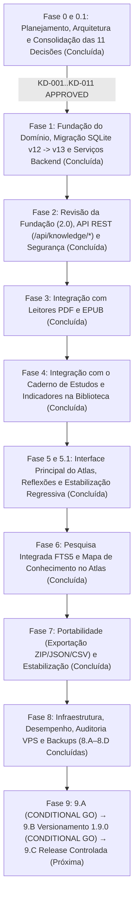

# Roadmap Incremental de Implementação — Lectoria v1.9.0

- **Versão Planejada**: `v1.9.0 — Conhecimento Conectado`
- **Branch de Desenvolvimento**: `feature/v1.9.0-connected-knowledge`
- **Premissa de Governança**: Cada fase depende da conclusão e validação 100% verde da fase anterior, preservando compatibilidade integral com os dados e funcionalidades da v1.8.0 (271 testes automatizados existentes).

---

## 1. Visão Geral e Sequência Recomendada das Fases

Avaliando as dependências técnicas entre persistência, serviços, API, leitores e interface principal, recomendamos uma **reorganização sutil entre as Fases 3 e 4** em relação à lista de partida:
- Na Fase 1 e Fase 2, o backend já entrega no banco SQLite v13 e na API REST tanto **Conceitos**, **Conexões (`knowledge_links`)**, **Backlinks** quanto **Reflexões**.
- Na interface, integrar primeiro **Conceitos, Conexões e Backlinks diretamente nos Leitores PDF/EPUB e no Caderno de Estudos (Fase 3)** e consolidar em seguida o **Espaço Principal de Conhecimento com Conceitos, Conexões, Backlinks e Reflexões Autorais (Fase 4/5)** evita retrabalho nos componentes de seleção de entidades e modais de vinculação.

---

## 2. Detalhamento Completo por Fase

### Fase 0 e 0.1 — Exploração Documental, Auditoria, Arquitetura e Decisões (Concluída)
- **Status**: `COMPLETE` (`KD-001` a `KD-011` aprovadas pelo proprietário em `09-owner-decisions.md`).
- **Objetivos**: Auditar o estado atual da v1.8.0, conceber a visão de produto e arquitetura da v1.9.0, modelar segurança e desempenho e consolidar as 11 decisões do proprietário (`KD-001` a `KD-011`, incluindo o nome oficial da seção principal: **Atlas**).
- **Pré-requisitos**: `v1.8.0` publicada em `main` e criação da branch `feature/v1.9.0-connected-knowledge`.
- **Entregáveis**: Os 11 documentos técnicos em `docs/v1.9.0/00-*.md` a `10-*.md`.
- **Arquivos afetados**: Exclusivamente `docs/v1.9.0/*.md`.
- **Riscos**: Zero (nenhum código ou banco alterado).
- **Testes necessários**: Confirmação de `git status` contendo apenas `docs/v1.9.0/`.
- **Critérios de aceitação e conclusão**: Todos os 11 documentos gerados e 11 decisões aprovadas pelo proprietário.
- **Estratégia de validação regressiva**: Nenhuma modificação em código executável.

---

### Fase 1 — Consolidação das Decisões, Fundação do Domínio e Migração SQLite (`v12 → v13`) (Concluída)
- **Status**: `PHASE_1_COMPLETE` (relatório detalhado em `docs/v1.9.0/11-phase-1-report.md`).
- **Objetivos**:
  - Consolidar as 11 decisões `APPROVED` na documentação de arquitetura da v1.9.0.
  - Implementar a migração incremental `_apply_migration_v13(cursor)` em `database.py` (elevando `SCHEMA_VERSION = 13`).
  - Criar as tabelas `concepts`, `reflections`, `knowledge_links` e a tabela virtual `knowledge_fts` (FTS5 com `tokenize='unicode61 remove_diacritics 2'`), mais índices compostos iniciados por `user_id` e triggers de integridade polimórfica e sincronização FTS.
  - Implementar o módulo `knowledge_service.py` (CRUD de conceitos, reflexões, conexões, backlinks, resolução centralizada `resolve_knowledge_entity` com *Read-Time Authorization* e indexação/busca de candidatos FTS5 com dupla barreira relacional).
- **Pré-requisitos**: Aprovação das 11 decisões (`KD-001` a `KD-011`).
- **Entregáveis Concluídos**:
  - Migração `_apply_migration_v13` transacional com backup pré-migração único (`lectoria_pre_migration_v12_to_v13.db.bak`).
  - Módulo `knowledge_service.py` desacoplado de `main.py`.
  - 6 novas suítes de testes automatizados (`test_v190_knowledge_migration.py`, `test_v190_knowledge_concepts.py`, `test_v190_knowledge_reflections.py`, `test_v190_knowledge_links.py`, `test_v190_knowledge_authorization.py`, `test_v190_knowledge_fts.py`) somando 31 novos testes (total da suíte: 262 testes unitários/integração + 40 testes E2E = 302 testes aprovados).
  - Relatório `docs/v1.9.0/11-phase-1-report.md`.
- **Critérios de aceitação e conclusão**: 100% dos 31 novos testes da Fase 1, 231 testes unitários/integração legados e 40 testes E2E aprovados (302 aprovados, 0 falhas, 0 ignorados).

---

### Fase 2 — Revisão da Fundação (2.0), API REST, Validação Pydantic e Segurança Anti-IDOR (Concluída)
- **Status**: `PHASE_2_COMPLETE` (relatórios em `docs/v1.9.0/12-phase-1-technical-review.md`, `13-knowledge-api-contracts.md` e `14-phase-2-report.md`).
- **Objetivos**:
  - Realizar a auditoria preliminar da fundação da Fase 1 (Fase 2.0), unificando a verificação de livros com `annotations_service._verify_book_access` e blindando o FTS5 contra exaustão de paginação por candidatos privados alheios.
  - Expor os 18 endpoints REST sob `/api/knowledge/*` (Conceitos, Reflexões, Conexões, Referências/Backlinks por Entidade e Localização Assistida `/api/knowledge/lookup`) em `main.py`.
  - Implementar modelos Pydantic v2 com `ConfigDict(extra="forbid")`, semântica rigorosa de `PATCH` parcial, proteção CSRF (`x-csrf-token` obrigatório no cabeçalho e bloqueado em query string para `/api/knowledge/*`) e cabeçalho `Cache-Control: private, no-store`.
- **Pré-requisitos**: Fase 1 concluída e aprovada.
- **Entregáveis Concluídos**:
  - Revisão técnica da Fase 1 (`docs/v1.9.0/12-phase-1-technical-review.md`) + 2 novos testes de regressão na fundação (`test_v190_knowledge_authorization.py`).
  - 18 rotas REST em `main.py` delegando integralmente a `knowledge_service.py`.
  - Documentação completa dos contratos REST (`docs/v1.9.0/13-knowledge-api-contracts.md`) e relatório da Fase 2 com handoff para a Fase 3 (`docs/v1.9.0/14-phase-2-report.md`).
  - 5 novas suítes de testes da API REST (`test_v190_knowledge_concepts_api.py`, `test_v190_knowledge_reflections_api.py`, `test_v190_knowledge_links_api.py`, `test_v190_knowledge_backlinks_api.py`, `test_v190_knowledge_lookup_api.py`, `test_v190_knowledge_api_security.py` — 6 arquivos, 14 testes de API).
- **Critérios de aceitação e conclusão**: Todos os 278 testes unitários/integração e 40 testes E2E aprovados (318 testes no total, 0 falhas, 0 ignorados).

---

### Fase 3 — Integração com os Leitores PDF e EPUB (Conceitos, Conexões e Backlinks em Leitura) (Concluída)
- **Status**: `PHASE_3_COMPLETE` (documentação técnica em `docs/v1.9.0/15-reader-knowledge-integration.md` e relatório com handoff em `docs/v1.9.0/16-phase-3-report.md`).
- **Objetivos**:
  - Permitir associar ou criar Conceitos e estabelecer Conexões diretamente durante a leitura em PDF e EPUB sem sobrecarregar a barra superior.
  - Exibir e gerenciar conceitos, conexões semânticas e backlinks de forma contextual a partir de `#highlight-popover` e `#page-note-popover` via modal compartilhado `#modal-reader-knowledge`.
- **Pré-requisitos**: Fase 2 concluída e aprovada.
- **Entregáveis Concluídos**:
  - Módulo compartilhado `static/js/reader-knowledge.js` e integração em `static/reader.html`, `static/js/reader.js` e `static/css/style.css`.
  - 3 novas suítes E2E Playwright (`tests/e2e/test_v190_pdf_knowledge.py`, `tests/e2e/test_v190_epub_knowledge.py`, `tests/e2e/test_v190_knowledge_reader_security.py`) com validação visual em desktop, tablet (`768px`) e mobile (`360px`).
  - Documentação técnica `15-reader-knowledge-integration.md` e relatório `16-phase-3-report.md`.
- **Critérios de aceitação e conclusão**: Zero overflow horizontal de `360px` a `1366px` e 100% da suíte aprovada (**278** unitários/integração + **43** E2E = **321** testes aprovados, 0 falhas, 0 ignorados).

---

### Fase 4 — Evolução do Caderno de Estudos e Indicadores na Biblioteca (Concluída)
- **Status**: `PHASE_4_COMPLETE` (documentação técnica em `docs/v1.9.0/17-study-notebook-knowledge-integration.md` e relatório com handoff em `docs/v1.9.0/18-phase-4-report.md`).
- **Objetivos**:
  - Integrar `#annotations-drawer` (Caderno de Estudos) ao Atlas com filtro por conexões (`Todas`, `Conectadas`, `Sem conexões`), indicadores pessoais da obra, chips discretos de conceitos, contadores de conexões/backlinks e acesso contextual ao modal `#modal-reader-knowledge` sem consultas N+1.
  - Adicionar na Biblioteca (`index.html` / `app.js`) a subaba contextual **Conhecimento** sob demanda no modal `#modal-book-details`.
- **Pré-requisitos**: Fase 3 concluída e aprovada.
- **Entregáveis Concluídos**:
  - Núcleo compartilhado `static/js/knowledge-api.js`, módulo `static/js/book-knowledge.js` e integração em `reader-knowledge.js`, `reader.js`, `reader.html`, `index.html`, `app.js` e `style.css`.
  - Endpoints sem N+1 `GET /api/knowledge/books/{book_id}/summary` e `POST /api/knowledge/entities/summary` + parâmetro `knowledge_filter` em `GET /api/books/{book_id}/annotations`.
  - 4 novas suítes de testes (`test_v190_phase4_summaries_and_filters.py`, `test_v190_study_notebook_knowledge.py`, `test_v190_library_knowledge.py`, `test_v190_notebook_knowledge_security.py`) e validação visual em desktop, tablet (`768px`) e mobile (`360px`).
- **Critérios de aceitação e conclusão**: Zero N+1 validado em Chromium, paginação e funcionalidades v1.8.0 preservadas e **326** testes aprovados (**280** unitários/integração + **46** E2E, 0 falhas, 0 ignorados).

---

### Fase 5 — Espaço Principal de Conhecimento: Conceitos, Conexões, Backlinks e Reflexões Autorais (Concluída)
- **Status**: `PHASE_5_COMPLETE` (documentação técnica em `docs/v1.9.0/19-atlas-interface-and-reflections.md` e relatório com handoff em `docs/v1.9.0/20-phase-5-report.md`).
- **Objetivos**:
  - Criar a nova seção principal na barra de navegação de `static/index.html` (`#tab-nav-atlas` e `#atlas-section`) e o módulo `static/js/knowledge.js`.
  - Implementar os quatro painéis: **Visão Geral** (`overview`), **Conceitos** (`concepts`), **Reflexões Autorais** (`reflections` com editor Markdown seguro construído 100% via DOM, contador em tempo real, inserção assistida de referências canônicas e prevenção contra perda de dados/concorrência) e **Conexões** (`connections`).
  - Implementar endpoint agregado de alta performance `GET /api/knowledge/summary`.
- **Pré-requisitos**: Fase 4 concluída e deliberação sobre o nome da seção (`KD-010`).
- **Entregáveis Concluídos**:
  - Aba principal `#tab-nav-atlas` e seção `#atlas-section` em `static/index.html` integradas a `static/js/app.js`.
  - Módulo `static/js/knowledge.js` (`window.LectoriaAtlas`), renderizador seguro `renderSafeMarkdownToDom` e utilitários em `static/js/knowledge-api.js`, estilos consolidados em `static/css/style.css`.
  - Endpoint `GET /api/knowledge/summary` (`knowledge_service.get_atlas_overview_summary`) com teste de escala quantitativa (1.000 conceitos, 1.000 reflexões, 10.000 links).
  - 5 novas suítes de testes (`test_v190_atlas_overview.py`, `test_v190_atlas_concepts.py`, `test_v190_atlas_reflections.py`, `test_v190_atlas_connections.py`, `test_v190_atlas_security.py`) e 11 capturas de tela aprovadas.
- **Fase 5.1 — Estabilização Regressiva (`PHASE_5_1_COMPLETE`, `docs/v1.9.0/21-phase-5-1-stabilization.md`)**:
  - Eliminação da causa raiz de bloqueio da suíte E2E completa (deadlock de buffer de pipe do subprocesso Uvicorn no 31º teste + esperas observáveis em `test_v160_reading_clubs_and_collective_reads_multiuser`).
  - Controle otimista de concorrência atômico no backend (`expected_updated_at` com resolução de microssegundos e `HTTP 409 Conflict`) para reflexões, suporte completo aos 5 tipos de entidade em `GET /api/knowledge/links?entity_type=...`, endurecimento de `persistProgress` e `renderSinglePage`.
- **Critérios de aceitação e conclusão**: Zero vulnerabilidades XSS ou DOM clobbering, isolamento multiusuário estrito e **333** testes aprovados (**283** unitários/integração + **50** E2E, 0 falhas, 0 ignorados).

---

### Fase 6 — Pesquisa Integrada (FTS5) e Mapa de Conhecimento (SVG Local + Alternativa Textual) (Concluída)
- **Status**: `PHASE_6_COMPLETE` (documentação técnica em `docs/v1.9.0/22-atlas-search-and-fts5.md`, `23-atlas-local-knowledge-graph.md` e relatório com handoff em `docs/v1.9.0/24-phase-6-report.md`).
- **Objetivos**:
  - Integrar a barra de pesquisa global de conhecimento (`GET /api/knowledge/search`) com filtro por tipo, suporte a acentos em português (`unicode61 remove_diacritics 2`), dupla barreira com autorização relacional integrada antes da paginação, relevância determinística sem vazamento estatístico BM25 IDF entre usuários e snippets estruturados seguros (`snippet_segments`).
  - Implementar o visualizador de **Grafo Local em SVG** (`GET /api/knowledge/graph`, vizinhança de 1 e 2 saltos, tetos rígidos de `max_nodes <= 80` incluindo o centro e `max_edges <= 160`, sentinelas neutros não expansíveis para referências indisponíveis, zero CPU ociosa) e sua **Alternativa Textual Estruturada** acessível por teclado e leitores de tela.
- **Pré-requisitos**: Fase 5 e Fase 5.1 concluídas e aprovadas.
- **Entregáveis Concluídos**:
  - Endpoints `GET /api/knowledge/search` e `GET /api/knowledge/graph` em `main.py` e funções `search_knowledge` e `get_knowledge_graph` em `knowledge_service.py`.
  - Subabas **Pesquisa** (`#atlas-subtab-search`, `#atlas-pane-search`) e **Mapa** (`#atlas-subtab-graph`, `#atlas-pane-graph`) em `static/js/knowledge.js`, métodos `searchKnowledge` e `getKnowledgeGraph` em `static/js/knowledge-api.js`, e ações contextuais `"Explorar no Mapa"` em conceitos, reflexões, resultados de busca e conexões.
  - 4 novas suítes de testes (`tests/test_v190_atlas_search_and_graph.py`, `tests/e2e/test_v190_atlas_search.py`, `tests/e2e/test_v190_atlas_graph.py`, `tests/e2e/test_v190_atlas_search_graph_security.py`) e 14 capturas de tela inspecionadas.
- **Critérios de aceitação e conclusão**: Hipóteses de escala (até 10.000 conceitos, 2.000 reflexões, 10.000 anotações e 50.000 conexões), planos de execução `EXPLAIN QUERY PLAN` e isolamento de segurança validados com **342** testes aprovados (**289** unitários/integração + **53** E2E, 0 falhas, 0 ignorados).

---

### Fase 7 — Portabilidade (Exportação Markdown ZIP / JSON / CSV) e Estabilização (Concluída)
- **Status**: `PHASE_7_COMPLETE` (documentação técnica em `docs/v1.9.0/25-atlas-export-formats.md` e relatório com handoff para a Fase 8 em `docs/v1.9.0/26-phase-7-report.md`).
- **Objetivos**:
  - Implementar `knowledge_export_service.py` e `GET /api/knowledge/export` (`format=markdown_zip|json|csv`) para exportar o conhecimento pessoal autorizado do usuário em pacote `.zip` de documentos Markdown interligados (com opção de wikilinks), `.json` v2.0 e pacote `.csv` tabular com proteção contra formula injection.
  - Validar segurança multiusuário, referências indisponíveis, política conservadora de terceiros, streaming em disco temporário e desempenho/memória com `tracemalloc`.
- **Pré-requisitos**: Fase 6 concluída e deliberação sobre `KD-009`.
- **Entregáveis Concluídos**:
  - Serviço `knowledge_export_service.py`, endpoint `GET /api/knowledge/export` em `main.py`, cliente e modal `#atlas-export-modal` em `knowledge-api.js`, `knowledge.js` e `style.css`.
  - Suítes `tests/test_v190_atlas_export_and_scale.py` (5 testes) e `tests/e2e/test_v190_atlas_export.py` (1 teste E2E com downloads reais e 7 capturas inspecionadas).
- **Critérios de aceitação e conclusão**: Todos os formatos, políticas de segurança, streaming/limpeza e testes regressivos aprovados.

---

### Fase 8 — Auditoria de Infraestrutura, Desempenho, Compatibilidade e Preparação Segura para Produção (`PHASE_8_COMPLETE_WITH_LIMITATIONS`)
- **Status**: `PHASE_8_COMPLETE_WITH_LIMITATIONS` — **Etapas A e B concluídas localmente**; **Etapa C (VPS/produção) pendente de autorização explícita do proprietário** e validação em contêiner Docker real (`docker`/`podman`/`systemd-run` ausentes no host local).
- **Documentação produzida**:
  - `docs/v1.9.0/27-infrastructure-audit.md` (auditoria Docker/Compose, Uvicorn, SQLite/WAL/FTS5, backup e frontend).
  - `docs/v1.9.0/28-performance-benchmarks.md` (benchmarks comparativos antes vs depois em escala real e extrema).
  - `docs/v1.9.0/29-production-readiness-and-rollback.md` (runbook classificado para VPS, `docker-compose.v190-candidate.yml`, patch não-root e plano de rollback v13 → v12).
  - `docs/v1.9.0/30-phase-8-report.md` (relatório consolidado e handoff).
- **Principais entregas da Etapa B**:
  - Desbloqueio do event loop em `main.py` (174 rotas convertidas para `def` + `run_in_threadpool` nas 9 rotas `async def`; `/api/health` máx. sob carga de 495,5 ms → 16,9 ms; semáforo de exportações efetivo) e thread-safety do rate limiter em `auth_service.py`.
  - Eliminação de N+1 e otimização de planos SQL em `knowledge_service.py`, `knowledge_export_service.py` e `library.py` (`list_reflections`: 2.004 → 6 SQLs; `export_snapshot`: 2.007 → 8 SQLs; busca FTS5 multi-termo -45,7%; grafo 2 saltos -42,3%).
  - Redução de 87,8% no payload inicial de `/` e eliminação de chamadas duplicadas em `static/js/app.js`.
  - Safety backup WAL-safe em `backup_service.py`.
  - Scripts reproduzíveis (`tests/performance/benchmark_v190_atlas.py`, `tests/performance/profile_v190_frontend.py`), 11 novos testes em `tests/test_v190_phase8_infra_and_migration.py` e arquivo candidato `docker-compose.v190-candidate.yml` (sem alterar `docker-compose.yml` nem `Dockerfile`).
- **Fase 8.C — Auditoria Supervisionada da VPS (`PHASE_8C_AUDIT_WITH_LIMITATIONS`)**:
  - Auditoria somente-leitura sem `sudo` concluída em 4 lotes (15 comandos SSH aprovados); documentação em `docs/v1.9.0/31-phase-8c-vps-audit.md`, `32-production-configuration-proposal.md` e `33-phase-8c-handoff.md`.
  - Principais descobertas: host de `1` vCPU / `3,8 GiB` RAM (`2,9 GiB` livres), produção v1.8.0 em `/srv/nosreme/lectoria/compose.yaml` usando bind mounts em `/storage/*`, acesso via `tailscale serve` → `127.0.0.1:8765`, cgroup real com `anon = 171,3 MiB` e `file = 578,9 MiB` (`768 MiB` sem OOM), `lectoria-auto-update.timer` a cada 15 min sobre `:stable`, e `nosreme-restic-backup.service` em `activating (start)` há ~71h10m (`TimeoutStartSec=0`, `NEXT = -`).
- **Fase 8.D — Diagnóstico e Descontinuação Voluntária do Backup Remoto (`PHASE_8D_COMPLETE`)**:
  - Diagnóstico administrativo concluído (`restic 0.16.4`, `rclone v1.60.1-DEV`, falha `403 RATE_LIMIT_EXCEEDED` no projeto OAuth compartilhado `202264815644`, travamento silencioso de 71h23m agravado por `TimeoutStartSec=0` e `Persistent=true`); documentação técnica preservada em `docs/v1.9.0/34-phase-8d-backup-recovery.md` e `35-backup-monitoring-and-reliability.md`.
  - Por decisão do proprietário, o backup externo Restic/Rclone foi descontinuado voluntariamente (`nosreme-restic-backup.timer` confirmado `disabled`/`inactive`, zero processos ativos, snapshots antigos preservados no Google Drive, scripts/unidades mantidos no disco e política `sudoers` temporária revogada).
  - O backup local diário da Lectoria (`lectoria-backup.timer` / `lectoria-backup.service`, `enabled`/`active`, `SQLite: backup íntegro.`) permanece como mecanismo principal de recuperação.
- **Critérios obrigatórios antes do deploy da v1.9.0**: backup SQLite local íntegro, cópia externa manual dos dados essenciais, plano de rollback `v12 → v13`, controle do `lectoria-auto-update.timer` antes do merge em `main`, validação isolada de `ENABLE_FTS5` na imagem Docker e preservação dos bind mounts `/storage/*`.

---

### Fase 9 — Validação Final, Versionamento `1.9.0` e Preparação da Release
- **Fase 9.A — Validação Final Pré-Release (`CONDITIONAL GO`, `docs/v1.9.0/36-phase-9a-final-validation.md`)**:
  - **359/359 testes aprovados** (`305` unitários/integração em `341,44s` + `54` E2E Playwright em `231,01s`, zero falhas, zero skips, `py_compile` exit `0`).
  - Migração isolada `v12 → v13` em banco sintético de porte real (`4,24 MB`, 6.500 anotações) concluída em **`82,83 ms`** com backup pré-migração íntegro, `PRAGMA integrity_check == ok`, `0` erros de FK e `6.500` linhas no `knowledge_fts`.
  - Benchmarks frescos confirmados (`/api/health` máx. sob exportação: `3,48 ms`, `VmHWM`: `161,55 MB`, 6× exports `{'200': 4, '503': 2}`).
- **Fase 9.B — Versionamento `1.9.0` e Preparação Final (`CONDITIONAL GO`, `docs/v1.9.0/37-phase-9b-release-readiness.md`)**:
  - Sincronizados `config.APP_VERSION = "1.9.0"`, `data-app-version="1.9.0"`, `LECTORIA_FRONTEND_VERSION = "1.9.0"`, cache-busting `?v=1.9.0` e `test_v151_frontend_backend_version_alignment` (preservando `SCHEMA_VERSION = 13`).
  - Atualizados `CHANGELOG.md`, `README.md`, `AGENTS.md`, `docs/ARCHITECTURE.md`, `DATABASE.md`, `API.md`, `AUTHORIZATION.md`, `FRONTEND.md`, `READER.md` e `docker-compose.v190-candidate.yml` (alinhado aos bind mounts `/storage/*`, `127.0.0.1:8765:8765`, `mem_limit: 1g`, sem `cpus: 1.5`).
  - Reexecutados todos os **359/359 testes automatizados** (`305` unitários/integração em `326,21s` + `54` E2E Playwright em `232,48s`, zero falhas, zero skips).
- **Fase 9.C — Publicação Controlada e Deploy Supervisionado (Próxima — Aguardando Aprovação)**:
  - Sincronizar `config.APP_VERSION = "1.9.0"`, `data-app-version="1.9.0"` e strings de cache-busting `?v=1.9.0` (`test_v151_frontend_backend_version_alignment`).
  - Atualizar `AGENTS.md`, `README.md`, `CHANGELOG.md` e documentação técnica (`docs/DATABASE.md`, `docs/API.md`, `docs/ARCHITECTURE.md`, `docs/AUTHORIZATION.md`, `docs/FRONTEND.md`, `docs/READER.md`).
  - Executar bateria final completa de testes (unitários, integração, API, segurança e E2E) e produzir o relatório de prontidão para release (`Release Readiness`).
- **Pré-requisitos**: Fases 1 a 8 concluídas com 100% de aprovação.
- **Entregáveis**:
  - Versão `1.9.0` alinhada, documentação consolidada e relatórios finais de validação e prontidão.
- **Arquivos potencialmente afetados**:
  - `config.py`, `static/index.html`, `static/reader.html`, `static/js/app.js`, `scripts/package.py`, `AGENTS.md`, `README.md`, `CHANGELOG.md`, `docs/*.md`.
- **Critérios de aceitação e conclusão**: 100% da suíte unitária, de integração e E2E aprovada com zero falhas e zero skips, pronta para autorização de merge e publicação pelo proprietário.

---

## 3. Roadmap Provisório de Longo Prazo (Pós-v1.9.0)

Para registrar a visão evolutiva da Lectoria sem iniciar implementações fora de escopo:

- **`v1.10.0` — Biblioteca Inteligente**: evolução da descoberta, organização editorial e recomendações assistidas sobre o acervo.
- **`v1.11.0` — Auditoria Aprofundada de Desempenho e Engenharia**: revisão estrutural ampla de arquitetura de desempenho, profiling de backend e frontend, otimização de consultas e engenharia de carga (escopo distinto da adequação pontual de infraestrutura prevista na Fase 8 da v1.9.0).
- **`v1.12.0` — Aplicativo**: estratégia e entrega de experiência dedicada em aplicativo para leitura e consulta do acervo.
